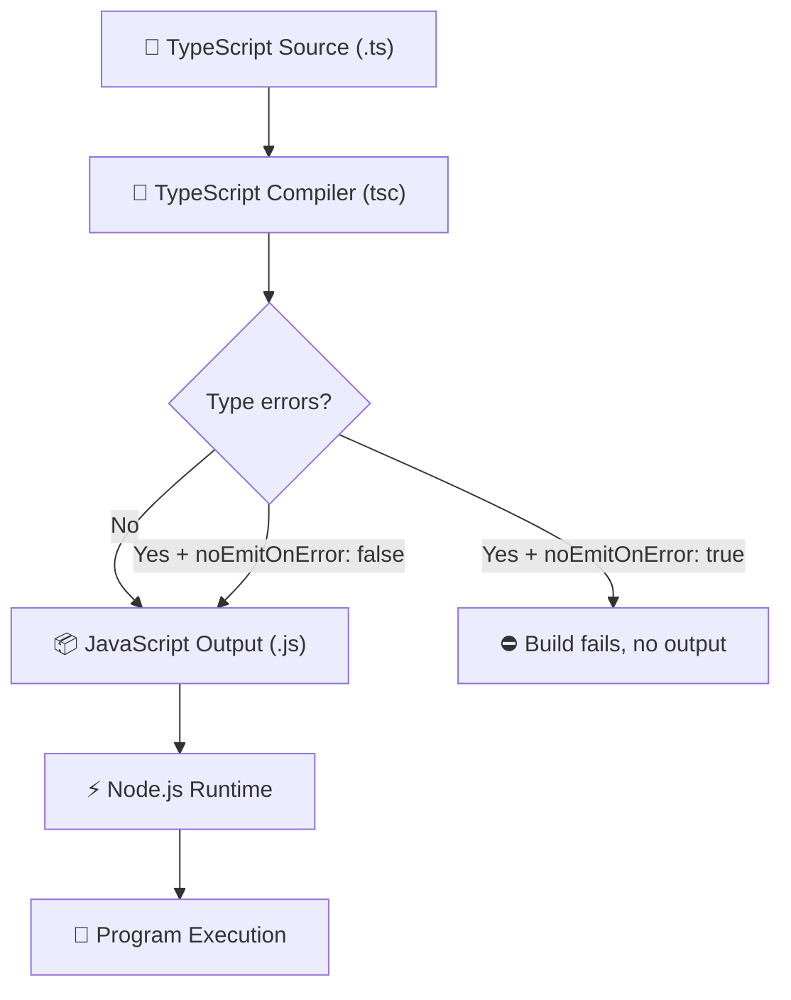
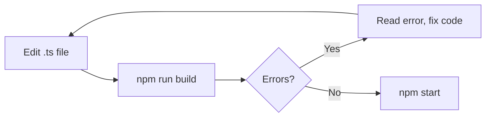
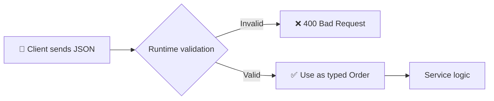

<div align="center">

# 🚀 Day 01 — TypeScript Fundamentals & Setup

### From "What is TypeScript?" to your first compiled project


**10 Days of TypeScript | Fundamentals → Real-World Backend Development**

*The goal is not just to write code that works. It's to write code that's easier to understand, maintain, debug and scale.*

</div>

---

## 🧭 How to Use This Guide

This is a **study kit**, not just notes. Follow this order for the best result:

| Step | What to do | Time |
|:---:|---|:---:|
| 1️⃣ | Read **Parts 1–3** (concepts) | 30 min |
| 2️⃣ | Do the **setup** and type every command yourself | 30 min |
| 3️⃣ | Understand **tsconfig.json** and **type checking** | 30 min |
| 4️⃣ | Complete **Tasks Level 1 → 3** (no peeking at solutions!) | 60 min |
| 5️⃣ | Solve the **Debugging Challenges** | 20 min |
| 6️⃣ | Build the **Mini Project** | 45 min |
| 7️⃣ | Take the **Quiz** and review **Interview Questions** | 30 min |

> [!TIP]
> **Golden rule:** Don't copy-paste code. Type it. Your fingers learn what your eyes skip.

---

## 📌 Table of Contents

| # | Section |
|:-:|---|
| 1 | [🎯 Learning Objectives](#-learning-objectives) |
| 2 | [📖 What Is TypeScript?](#-what-is-typescript) |
| 3 | [💡 Why Do We Need TypeScript?](#-why-do-we-need-typescript) |
| 4 | [⚖️ JavaScript vs TypeScript](#️-javascript-vs-typescript) |
| 5 | [⚙️ How TypeScript Works Internally](#️-how-typescript-works-internally) |
| 6 | [🛠️ Prerequisites](#️-prerequisites) |
| 7 | [📁 Project Setup (Step by Step)](#-project-setup-step-by-step) |
| 8 | [🧠 Understanding tsconfig.json](#-understanding-tsconfigjson) |
| 9 | [🔍 Type Checking in Action](#-type-checking-in-action) |
| 10 | [🌍 Real-World Backend Example](#-real-world-backend-example) |
| 11 | [❌ Common Mistakes & Error Messages](#-common-mistakes--error-messages) |
| 12 | [🧪 Hands-On Tasks (Level 1–3)](#-hands-on-tasks) |
| 13 | [🐞 Debugging Challenges](#-debugging-challenges) |
| 14 | [🏗️ Mini Project: Shop Billing](#️-mini-project-shop-billing-calculator) |
| 15 | [📝 Quiz](#-quiz-test-yourself) |
| 16 | [🎤 Interview Questions](#-interview-questions) |
| 17 | [📄 Cheat Sheet](#-day-1-cheat-sheet) |
| 18 | [📚 Glossary](#-glossary) |
| 19 | [🛟 Troubleshooting](#-troubleshooting) |
| 20 | [✅ Progress Tracker](#-progress-tracker) |
| 21 | [🔜 What's Next](#-day-2--basic-types--type-inference) |

---

## 🎯 Learning Objectives

By the end of Day 1, you should be able to:

- [ ] Explain what TypeScript is and how it relates to JavaScript
- [ ] Explain static type checking and type inference
- [ ] List the differences between JavaScript and TypeScript
- [ ] Draw the TypeScript compilation flow from memory
- [ ] Set up a TypeScript project using Node.js and npm
- [ ] Write, compile and run a `.ts` file
- [ ] Configure the compiler using `tsconfig.json`
- [ ] Explain what the compiler **can** catch and what it **cannot**

---

## 📖 What Is TypeScript?

TypeScript is a **strongly typed programming language built on top of JavaScript**. It adds a **type system** and **compile-time checking**. It is open-source and maintained by Microsoft.

> **TypeScript = JavaScript + Types**

### 🧩 Real-life analogy

Think of **Microsoft Word's spell-checker**:

| Writing a document | Writing code |
|---|---|
| You can write anything without a spell-checker | JavaScript lets you write anything |
| Spell-checker underlines mistakes **while you type** | TypeScript underlines mistakes **before you run** |
| The final printed page has no red lines | The final JavaScript has no types |

TypeScript is a spell-checker for your code. After checking, it hands over normal JavaScript.

### Example: JavaScript

```javascript
function add(a, b) {
  return a + b;
}

console.log(add(10, 20));   // 30
console.log(add("10", 20)); // "1020"  <-- surprise! string joining, not addition
```

JavaScript happily accepts both. There is no warning, and the bug appears later in production.

### Example: TypeScript

```typescript
function add(a: number, b: number): number {
  return a + b;
}

console.log(add(10, 20)); // 30

// ❌ Compile-time error:
// Argument of type 'string' is not assignable to parameter of type 'number'.
console.log(add("10", 20));
```

Read the signature like English:

| Part | Meaning |
|---|---|
| `a: number` | `a` must be a number |
| `b: number` | `b` must be a number |
| `): number` | the function returns a number |

> [!IMPORTANT]
> TypeScript checks types **while you develop/compile**. It does **not** automatically validate data that arrives at runtime (HTTP requests, user input, database rows, third-party APIs).

---

## 💡 Why Do We Need TypeScript?

Small scripts are easy to manage. Big projects with many files and many developers are not. TypeScript gives different parts of your code a **clear contract**.

### 1. Catch errors earlier

```typescript
let age: number = 22;

// ❌ Type 'string' is not assignable to type 'number'.
age = "twenty-two";
```

### 2. Code explains itself

```typescript
function calculatePrice(price: number, quantity: number): number {
  return price * quantity;
}
```

Without reading the body you already know: two numbers in, one number out.

### 3. Better editor support (VS Code)

- Autocomplete that actually knows your data
- Hover to see types
- Jump to definition
- Rename a variable across the whole project safely
- Red underlines before you run

### 4. Safer refactoring

Change a function signature and the compiler shows **every place** that needs fixing.

### 5. Better backend structure


Every arrow is data moving between layers. TypeScript describes what that data looks like.

### ⚠️ What TypeScript does NOT guarantee

| TypeScript cannot guarantee | You still need |
|---|---|
| API request contains valid data | Runtime validation |
| Database query will succeed | Error handling |
| Network stays available | Retries / timeouts |
| External API returns expected shape | Validation of responses |
| Business logic is correct | Tests |
| App is secure | Security practices |

---

## ⚖️ JavaScript vs TypeScript

| Feature | JavaScript | TypeScript |
|---|---|---|
| File extension | `.js` | `.ts` |
| Type annotations | ❌ Not in ordinary JS syntax | ✅ Supported |
| Type checking | Mostly at runtime | At compile time |
| Needs compiling? | No (for plain Node.js) | Usually yes (converted to JS) |
| Type inference | Runtime values decide | Compiler infers types |
| Editor support | Good | Excellent, type-aware |
| Runs on | JavaScript runtime | **Same** JavaScript runtime |
| Learning curve | Lower at first | Extra concepts to learn |

> **Key takeaway:** TypeScript does **not** replace JavaScript's runtime. The final output is always JavaScript.

---

## ⚙️ How TypeScript Works Internally

Node.js does not understand TypeScript syntax in the conventional workflow. The TypeScript compiler (`tsc`) checks your code and converts it to JavaScript.



### Try it yourself (quick demo)

**Step 1 — write TypeScript**

```typescript
const username: string = "Developer";
console.log(username);
```

**Step 2 — compile**

```bash
npx tsc src/index.ts
```

**Step 3 — look at the generated JavaScript**

```javascript
const username = "Developer";
console.log(username);
```

Notice: `: string` has **disappeared**. Types exist only during development.

**Step 4 — run the JavaScript**

```bash
node src/index.js
```

```text
Developer
```

### 🔑 Important compiler behavior

By default, `tsc` can **still emit JavaScript even when there are type errors**. This is controlled by `noEmitOnError`. In our project we turn it on, so a failed type check = no new output.

### 🧠 Two worlds: compile time vs runtime

| | Compile time | Runtime |
|---|---|---|
| **When** | Before the app runs | While the app runs |
| **Who** | TypeScript compiler | Node.js |
| **What exists** | Types, interfaces | Only JavaScript values |
| **Catches** | Wrong types in your code | Nothing automatically |

---

## 🛠️ Prerequisites

| Tool | Why | Required? |
|---|---|:---:|
| **Node.js** (current LTS) | Runs JavaScript | ✅ |
| **npm** | Installs packages (comes with Node) | ✅ |
| **VS Code** | Editor with great TS support | ⭐ Recommended |
| **Git** | Version control | ⭐ Recommended |

Verify installation:

```bash
node --version
npm --version
git --version
```

Each command should print a version number. If not, install the tool and **reopen your terminal**.

---

## 📁 Project Setup (Step by Step)

### Step 1 — Create the project

```bash
mkdir typescript-day-01
cd typescript-day-01
npm init -y
```

`npm init -y` creates `package.json` (project info + scripts).

> ✅ **Checkpoint:** you should see `package.json` in the folder.

### Step 2 — Install TypeScript

```bash
npm install --save-dev typescript
npm install --save-dev @types/node
```

| Package | Purpose |
|---|---|
| `typescript` | The compiler (`tsc`) and tooling |
| `@types/node` | Type definitions for Node.js APIs (`console`, `process`, `fs`...) |

They are **dev dependencies** because they're needed while developing, not when running the compiled output.

> ✅ **Checkpoint:** run `npx tsc --version`. You should see a version number.

### Step 3 — Create `tsconfig.json`

```bash
npx tsc --init
```

Replace the contents with this beginner-friendly config:

```json
{
  "compilerOptions": {
    "target": "ES2022",
    "module": "CommonJS",
    "moduleResolution": "Node",
    "rootDir": "./src",
    "outDir": "./dist",
    "strict": true,
    "esModuleInterop": true,
    "forceConsistentCasingInFileNames": true,
    "skipLibCheck": true,
    "noEmitOnError": true,
    "types": ["node"]
  },
  "include": ["src/**/*.ts"],
  "exclude": ["node_modules", "dist"]
}
```

### Step 4 — Create the folder structure

```text
typescript-day-01/
├── src/
│   └── index.ts        ← you write this
├── dist/               ← generated by the compiler (don't create it)
├── node_modules/       ← generated by npm
├── package.json
├── package-lock.json
└── tsconfig.json
```

### Step 5 — Add npm scripts

Merge this into the `scripts` section of `package.json` (keep your other fields):

```json
{
  "scripts": {
    "build": "tsc",
    "start": "node dist/index.js",
    "typecheck": "tsc --noEmit"
  }
}
```

| Script | Command | What it does |
|---|---|---|
| `npm run build` | `tsc` | Check types + generate JS in `dist/` |
| `npm start` | `node dist/index.js` | Run the compiled JS |
| `npm run typecheck` | `tsc --noEmit` | Only check types, generate nothing |

### Step 6 — Write your first file

`src/index.ts`

```typescript
const message: string = "Hello, TypeScript!";

console.log(message);
```

### Step 7 — Build

```bash
npm run build
```

> ✅ **Checkpoint:** `dist/index.js` now exists. Open it and compare with your `.ts` file!

### Step 8 — Run

```bash
npm start
```

```text
Hello, TypeScript!
```

### Step 9 — Type check only

```bash
npm run typecheck
```

> 🎉 **Congratulations!** You've completed your first TypeScript workflow:
> **write → build → run.**

### 🔁 Your daily workflow



---

## 🧠 Understanding tsconfig.json

`tsconfig.json` tells TypeScript **what to compile** and **how to compile it**.

| Option | Purpose | In plain words |
|---|---|---|
| `target` | JavaScript version generated | "Which JS flavour should I output?" |
| `module` | Module format generated | "How should files import each other?" |
| `moduleResolution` | How imports are located | "How do I find imported files/packages?" |
| `rootDir` | Source folder | "My `.ts` files live here" |
| `outDir` | Output folder | "Put generated `.js` here" |
| `strict` | Enables strict checks | "Be a strict teacher" |
| `esModuleInterop` | Smoother CommonJS imports | "Make old and new import styles friends" |
| `forceConsistentCasingInFileNames` | Enforces import casing | "`User.ts` ≠ `user.ts`" |
| `skipLibCheck` | Skips checking `.d.ts` files | "Faster builds" |
| `noEmitOnError` | No output if errors exist | "Don't hand over broken work" |
| `types` | Which `@types` packages load automatically | "Only load Node types" |
| `include` | Files to compile | "Compile these" |
| `exclude` | Files to ignore | "Skip these" |

### 🔍 Deep dive: `strict: true`

`strict` is an umbrella that switches on several strict checks (such as `noImplicitAny` and `strictNullChecks`).

```typescript
function greet(name: string) {
  return `Hello, ${name}`;
}

greet("Developer"); // ✅
greet(123);         // ❌ Argument of type 'number' is not assignable to parameter of type 'string'.
```

Without a type on a parameter, strict mode complains:

```typescript
// ❌ Parameter 'name' implicitly has an 'any' type.
function greet(name) {
  return `Hello, ${name}`;
}
```

> [!TIP]
> Always start new projects with `"strict": true`. Turning it on later is painful.

### 🔍 Deep dive: `rootDir` and `outDir`

```text
src/index.ts   ──tsc──▶   dist/index.js
src/utils/math.ts ─────▶  dist/utils/math.js
```

The folder structure inside `src/` is mirrored inside `dist/`.

### 🔍 Deep dive: `include` and `exclude`

```json
"include": ["src/**/*.ts"]
```

`**` means "any number of folders" and `*.ts` means "any TypeScript file". So this matches every `.ts` file under `src/`.

---

## 🔍 Type Checking in Action

### Example 1 — Correct assignments

```typescript
const username: string = "Jerome";
const age: number = 21;
const isDeveloper: boolean = true;

console.log(username);
console.log(age);
console.log(isDeveloper);
```

```text
Jerome
21
true
```

### Example 2 — Incorrect assignment

```typescript
const age: number = "twenty-one";
```

```text
Type 'string' is not assignable to type 'number'.
```

Fix:

```typescript
const age: number = 21;
```

### Example 3 — Type inference

TypeScript can figure out types by itself:

```typescript
let score = 100;     // inferred as number

score = 150;         // ✅
score = "high";      // ❌ Type 'string' is not assignable to type 'number'.
```

Hover over `score` in VS Code and you'll see `let score: number`.

| Style | Code | When to use |
|---|---|---|
| **Annotation** (you write the type) | `let score: number = 100;` | Function parameters, return types, public contracts |
| **Inference** (TS figures it out) | `let score = 100;` | Simple local variables where the value makes it obvious |

### Example 4 — `const` vs `let` inference

```typescript
let city = "Chennai";     // type: string
const country = "India";  // type: "India" (a literal type!)
```

`const` can never change, so TypeScript infers the most exact type. You'll study literal types in the coming days.

### Example 5 — Function with return type

```typescript
function calculateTotal(price: number, quantity: number): number {
  return price * quantity;
}

const total = calculateTotal(250, 3);
console.log(total); // 750
```

### Example 6 — Wrong return type

```typescript
function getAge(): number {
  return "twenty"; // ❌ Type 'string' is not assignable to type 'number'.
}
```

### Example 7 — Objects

```typescript
const student: { name: string; marks: number } = {
  name: "Priya",
  marks: 92,
};

console.log(student.name);   // ✅
console.log(student.grade);  // ❌ Property 'grade' does not exist on type '{ name: string; marks: number; }'.
```

TypeScript catches **typos in property names** too. 🎯

---

## 🌍 Real-World Backend Example

You're building an e-commerce backend and need to calculate an order total.

```typescript
interface Order {
  productName: string;
  price: number;
  quantity: number;
}

function calculateOrderTotal(order: Order): number {
  return order.price * order.quantity;
}

const order: Order = {
  productName: "Mechanical Keyboard",
  price: 2500,
  quantity: 2,
};

console.log(calculateOrderTotal(order)); // 5000
```

### What did we learn?

| Code | Meaning |
|---|---|
| `interface Order` | Describes the **shape** of an order |
| `price: number` | Price must be a number |
| `calculateOrderTotal(order: Order)` | Accepts only objects matching `Order` |
| `: number` | Returns a number |

If a developer passes `quantity: "two"` in typed code, the compiler warns immediately.

### 🚨 Critical backend limitation

`interface Order` **disappears after compilation**. It cannot check JSON coming from a real client:

```json
{
  "productName": "Mechanical Keyboard",
  "price": 2500,
  "quantity": "two"
}
```

TypeScript would never know. Always **validate external data at runtime** (a validation library or manual checks) before trusting it.



---

## ❌ Common Mistakes & Error Messages

### Mistakes

| # | Mistake | Why it's a problem | Fix |
|:-:|---|---|---|
| 1 | Running `node src/index.ts` | Standard Node.js flow expects JavaScript | `npm run build` then `npm start` |
| 2 | Thinking types exist at runtime | They're erased during compilation | Add runtime validation for external data |
| 3 | Using `any` everywhere | Turns off type checking for that value | Use proper types; learn `unknown` on Day 2 |
| 4 | Ignoring compiler errors | Bugs slip through | Read the message, fix the cause |
| 5 | Treating types as tests | Types don't prove logic is correct | Write tests |
| 6 | Forgetting to rebuild | `npm start` runs old `dist/` code | Run `npm run build` first |

> [!NOTE]
> Some newer Node.js versions can run `.ts` files directly using *type stripping*. That is **not** the same as full compilation and type checking, so in this course we use the build workflow.

### 🔤 How to read a TypeScript error

```text
src/index.ts:5:7 - error TS2322: Type 'string' is not assignable to type 'number'.

5 const age: number = "twenty-one";
        ~~~
```

| Part | Meaning |
|---|---|
| `src/index.ts` | File |
| `5:7` | Line 5, column 7 |
| `TS2322` | Error code (Google it!) |
| Message | What went wrong |
| `~~~` | Exact spot |

### 📋 Errors you'll see often

| Error message (shortened) | Usually means |
|---|---|
| `Type 'X' is not assignable to type 'Y'` | You gave the wrong kind of value |
| `Argument of type 'X' is not assignable to parameter of type 'Y'` | Wrong value passed to a function |
| `Expected 2 arguments, but got 1` | Missing function argument |
| `Property 'x' does not exist on type 'Y'` | Typo or property not defined |
| `Cannot assign to 'x' because it is a constant` | You reassigned a `const` |
| `Parameter 'x' implicitly has an 'any' type` | Missing type annotation (strict mode) |
| `Cannot find name 'console'` | `@types/node` is missing or not configured |

---

## 🧪 Hands-On Tasks

> [!IMPORTANT]
> Create a file for each task in `src/` (for example `src/task1.ts`) and run it with `npm run build && node dist/task1.js`.
> Try on your own first. Solutions are hidden at the end of each level.

### 🟢 Level 1 — Warm-up (15–20 min)

#### Task 1.1 — Personal profile

Create variables for your **name**, **age**, **current learning topic** and **whether you're learning TypeScript**. Give each an appropriate type and print them all.

#### Task 1.2 — Multiply

Write `multiplyNumbers()` that accepts two numbers and returns their product, with an explicit return type. Test it with **at least 3 inputs**.

#### Task 1.3 — Product details

Create an object for a product with `id`, `name`, `price`, `inStock`. Give each property a type and print the details.

#### Task 1.4 — Find the error

```typescript
const username: string = "Developer";
let age: number = 22;

console.log(username);
console.log(age);

age = "twenty-two";
```

1. What error does TypeScript report?
2. Why does it happen?
3. How do you fix it?

#### Task 1.5 — Inference

```typescript
let total = 100;

total = 200;
total = "two hundred";
```

1. What type is inferred for `total`?
2. Which assignment fails?
3. How could a value be *either* number or string? (You'll learn this on Day 5; just make a guess!)

<details>
<summary>✅ Click for Level 1 solutions</summary>

**1.1**

```typescript
const fullName: string = "Jerome";
let age: number = 21;
const currentTopic: string = "TypeScript";
const isLearningTypeScript: boolean = true;

console.log(fullName, age, currentTopic, isLearningTypeScript);
```

**1.2**

```typescript
function multiplyNumbers(a: number, b: number): number {
  return a * b;
}

console.log(multiplyNumbers(2, 3));   // 6
console.log(multiplyNumbers(10, 5));  // 50
console.log(multiplyNumbers(7, 0));   // 0
```

**1.3**

```typescript
const product: { id: number; name: string; price: number; inStock: boolean } = {
  id: 1,
  name: "Wireless Mouse",
  price: 799,
  inStock: true,
};

console.log(product);
```

**1.4**

1. `Type 'string' is not assignable to type 'number'.`
2. `age` was declared as `number`, but `"twenty-two"` is a string.
3. Assign a number: `age = 23;`

> Note: if `age` were declared with `const`, TypeScript would report a different error: *"Cannot assign to 'age' because it is a constant."* That's why this version uses `let`.

**1.5**

1. `number`
2. `total = "two hundred";`
3. A *union type*: `number | string` (Day 5).

</details>

---

### 🟡 Level 2 — Practice (20–25 min)

#### Task 2.1 — Temperature converter

Write `celsiusToFahrenheit(celsius)` using `F = C × 9/5 + 32`. Test with `0`, `37`, `100`.

#### Task 2.2 — Full name

Write `getFullName(first, last)` that returns `"First Last"`.

#### Task 2.3 — Adult check

Write `isAdult(age)` that returns `true` if age is 18 or more. The return type must be `boolean`.

#### Task 2.4 — Average marks

Write `calculateAverage(marks)` where `marks` is an array of numbers (`number[]`). Return the average.

> 💡 *Sneak peek:* `number[]` means "an array of numbers". Arrays get full coverage on Day 2.

#### Task 2.5 — Student object

Create an `interface Student` with `name`, `rollNo`, `marks` (`number[]`). Write `getStudentSummary(student)` that returns a string like:

```text
Priya (Roll 12) - Average: 88.33
```

Hint: use `.toFixed(2)`.

<details>
<summary>✅ Click for Level 2 solutions</summary>

**2.1**

```typescript
function celsiusToFahrenheit(celsius: number): number {
  return (celsius * 9) / 5 + 32;
}

console.log(celsiusToFahrenheit(0));   // 32
console.log(celsiusToFahrenheit(37));  // 98.6
console.log(celsiusToFahrenheit(100)); // 212
```

**2.2**

```typescript
function getFullName(first: string, last: string): string {
  return `${first} ${last}`;
}

console.log(getFullName("Jerome", "Kumar"));
```

**2.3**

```typescript
function isAdult(age: number): boolean {
  return age >= 18;
}

console.log(isAdult(17)); // false
console.log(isAdult(18)); // true
```

**2.4**

```typescript
function calculateAverage(marks: number[]): number {
  let sum = 0;
  for (const mark of marks) {
    sum += mark;
  }
  return sum / marks.length;
}

console.log(calculateAverage([90, 80, 100])); // 90
```

> Edge case to think about: what happens with an empty array? (`0 / 0` is `NaN`.) Types don't protect you from this. Logic and tests do.

**2.5**

```typescript
interface Student {
  name: string;
  rollNo: number;
  marks: number[];
}

function getStudentSummary(student: Student): string {
  let sum = 0;
  for (const mark of student.marks) {
    sum += mark;
  }
  const average = sum / student.marks.length;
  return `${student.name} (Roll ${student.rollNo}) - Average: ${average.toFixed(2)}`;
}

console.log(
  getStudentSummary({ name: "Priya", rollNo: 12, marks: [90, 85, 90] })
);
// Priya (Roll 12) - Average: 88.33
```

</details>

---

### 🔴 Level 3 — Challenge (25–30 min)

#### Task 3.1 — Discount calculator

Write `applyDiscount(price, percent)` that returns the price after discount. Example: `applyDiscount(1000, 20)` → `800`.

#### Task 3.2 — Order total with `interface`

Create `interface OrderItem { name: string; price: number; quantity: number }` and write `getOrderTotal(items)` that returns the total of all items.

#### Task 3.3 — Prove types vanish ✨

1. Write a typed function in `src/index.ts`.
2. Run `npm run build`.
3. Open `dist/index.js`. List **three things** that disappeared.

#### Task 3.4 — `noEmitOnError` experiment

1. Add an intentional type error.
2. Run `npm run build`. Does `dist/index.js` update?
3. Set `"noEmitOnError": false`, repeat. What changes?
4. Set it back to `true`.

#### Task 3.5 — Runtime validation (stretch 🌟)

Write `isValidOrder(data: unknown): boolean` that returns `true` only if `data` is an object with `productName` (string), `price` (number) and `quantity` (number). Test it with the "bad JSON" from the backend example.

> 💡 `unknown` means "I don't know the type yet, so I must check before using it". It's covered in detail on Day 2.

<details>
<summary>✅ Click for Level 3 solutions</summary>

**3.1**

```typescript
function applyDiscount(price: number, percent: number): number {
  return price - (price * percent) / 100;
}

console.log(applyDiscount(1000, 20)); // 800
```

**3.2**

```typescript
interface OrderItem {
  name: string;
  price: number;
  quantity: number;
}

function getOrderTotal(items: OrderItem[]): number {
  let total = 0;
  for (const item of items) {
    total += item.price * item.quantity;
  }
  return total;
}

console.log(
  getOrderTotal([
    { name: "Pen", price: 10, quantity: 5 },
    { name: "Notebook", price: 50, quantity: 2 },
  ])
); // 150
```

**3.3** Things that disappear: the type annotations (`: number`), the `interface` declarations entirely, and any type-only syntax.

**3.4**
- With `noEmitOnError: true`: the build fails and `dist/index.js` is **not** updated.
- With `noEmitOnError: false`: errors are still reported, but JavaScript is still emitted.

**3.5**

```typescript
function isValidOrder(data: unknown): boolean {
  if (typeof data !== "object" || data === null) {
    return false;
  }

  const obj = data as Record<string, unknown>;

  return (
    typeof obj.productName === "string" &&
    typeof obj.price === "number" &&
    typeof obj.quantity === "number"
  );
}

console.log(
  isValidOrder({ productName: "Keyboard", price: 2500, quantity: "two" })
); // false
console.log(
  isValidOrder({ productName: "Keyboard", price: 2500, quantity: 2 })
); // true
```

This is exactly the kind of check TypeScript cannot do for you at runtime.

</details>

---

## 🐞 Debugging Challenges

Each snippet has a bug. Predict the error **before** running it.

#### 🐛 Challenge 1

```typescript
let count: number = "5";
console.log(count + 1);
```

#### 🐛 Challenge 2

```typescript
function add(a: number, b: number): number {
  return a + b;
}

console.log(add(1));
```

#### 🐛 Challenge 3

```typescript
const user = { name: "Arun", city: "Chennai" };
console.log(user.age);
```

#### 🐛 Challenge 4

```typescript
function getTotal(price: number, qty: number): number {
  console.log(price * qty);
}
```

#### 🐛 Challenge 5

```typescript
function greet(name) {
  return "Hello " + name;
}
```

<details>
<summary>✅ Click for answers</summary>

| # | Error | Fix |
|:-:|---|---|
| 1 | `Type 'string' is not assignable to type 'number'.` | `let count: number = 5;` |
| 2 | `Expected 2 arguments, but got 1.` | `add(1, 2)` |
| 3 | `Property 'age' does not exist on type '{ name: string; city: string; }'.` | Add `age` to the object or remove the access |
| 4 | `A function whose declared type is neither 'undefined', 'void', nor 'any' must return a value.` | `return price * qty;` |
| 5 | `Parameter 'name' implicitly has an 'any' type.` (with `strict: true`) | `function greet(name: string)` |

</details>

---

## 🏗️ Mini Project: Shop Billing Calculator

Build a small billing program for a shop. This ties together everything from Day 1.

### 📋 Requirements

Create `src/billing.ts` with:

1. `interface Product { id: number; name: string; price: number }`
2. `interface CartItem { product: Product; quantity: number }`
3. `calculateSubtotal(cart: CartItem[]): number`
4. `applyDiscount(amount: number, percent: number): number`
5. `calculateGST(amount: number, rate: number): number` (use 18%)
6. `formatCurrency(amount: number): string` that formats as Indian Rupees
7. Print a bill like this:

```text
=========== SHOP BILL ===========
Keyboard x 1      ₹2,500.00
Mouse x 2         ₹1,200.00
---------------------------------
Subtotal:         ₹3,700.00
Discount (10%):   -₹370.00
After discount:   ₹3,330.00
GST (18%):        ₹599.40
---------------------------------
TOTAL:            ₹3,929.40
=================================
```

> Spacing doesn't need to be perfect. Focus on getting the numbers right.

### 🧱 Starter code

```typescript
interface Product {
  id: number;
  name: string;
  price: number;
}

interface CartItem {
  product: Product;
  quantity: number;
}

function calculateSubtotal(cart: CartItem[]): number {
  // TODO
  return 0;
}

function applyDiscount(amount: number, percent: number): number {
  // TODO
  return 0;
}

function calculateGST(amount: number, rate: number): number {
  // TODO
  return 0;
}

function formatCurrency(amount: number): string {
  // TODO
  return "";
}

const cart: CartItem[] = [
  { product: { id: 1, name: "Keyboard", price: 2500 }, quantity: 1 },
  { product: { id: 2, name: "Mouse", price: 600 }, quantity: 2 },
];

// TODO: calculate and print the bill
```

### 🌟 Bonus ideas

- [ ] Reject negative prices or quantities
- [ ] Add a `category` field and a different discount per category
- [ ] Print each line using a helper function with a return type
- [ ] Add `npm run typecheck` to your workflow before every run

<details>
<summary>✅ Click for a sample solution</summary>

```typescript
interface Product {
  id: number;
  name: string;
  price: number;
}

interface CartItem {
  product: Product;
  quantity: number;
}

function calculateSubtotal(cart: CartItem[]): number {
  let subtotal = 0;
  for (const item of cart) {
    subtotal += item.product.price * item.quantity;
  }
  return subtotal;
}

function applyDiscount(amount: number, percent: number): number {
  return amount - (amount * percent) / 100;
}

function calculateGST(amount: number, rate: number): number {
  return (amount * rate) / 100;
}

function formatCurrency(amount: number): string {
  return amount.toLocaleString("en-IN", {
    style: "currency",
    currency: "INR",
  });
}

const cart: CartItem[] = [
  { product: { id: 1, name: "Keyboard", price: 2500 }, quantity: 1 },
  { product: { id: 2, name: "Mouse", price: 600 }, quantity: 2 },
];

const discountPercent = 10;
const gstRate = 18;

const subtotal = calculateSubtotal(cart);
const discounted = applyDiscount(subtotal, discountPercent);
const gst = calculateGST(discounted, gstRate);
const total = discounted + gst;

console.log("=========== SHOP BILL ===========");
for (const item of cart) {
  const line = item.product.price * item.quantity;
  console.log(`${item.product.name} x ${item.quantity}  ${formatCurrency(line)}`);
}
console.log("---------------------------------");
console.log(`Subtotal:        ${formatCurrency(subtotal)}`);
console.log(`Discount (${discountPercent}%):  -${formatCurrency(subtotal - discounted)}`);
console.log(`After discount:  ${formatCurrency(discounted)}`);
console.log(`GST (${gstRate}%):       ${formatCurrency(gst)}`);
console.log("---------------------------------");
console.log(`TOTAL:           ${formatCurrency(total)}`);
console.log("=================================");
```

> Currency formatting output can vary slightly by Node.js/ICU version (for example the exact spacing around `₹`), but the numbers will match.

</details>

---

## 📝 Quiz: Test Yourself

Answer first, then open the answers.

**Q1.** What does TypeScript compile to?
- A) Python
- B) JavaScript
- C) Java
- D) Machine code

**Q2.** Which command creates a `tsconfig.json`?
- A) `npm init -y`
- B) `tsc --create`
- C) `npx tsc --init`
- D) `node tsconfig`

**Q3.** What happens to type annotations after compilation?
- A) They become comments
- B) They are validated at runtime
- C) They are removed
- D) They become strings

**Q4.** What type does TypeScript infer here? `let x = 10;`
- A) `any`
- B) `string`
- C) `number`
- D) `unknown`

**Q5.** Which option stops `tsc` from emitting files when there are errors?
- A) `strict`
- B) `noEmitOnError`
- C) `skipLibCheck`
- D) `outDir`

**Q6.** Does an `interface` validate an incoming HTTP request body at runtime?
- A) Yes, automatically
- B) Only in strict mode
- C) No
- D) Only in Express

**Q7.** Why is `@types/node` installed?
- A) To run Node faster
- B) To provide type declarations for Node.js APIs
- C) To compile JavaScript
- D) To replace npm

**Q8.** What does `npm run typecheck` (`tsc --noEmit`) do?
- A) Builds and runs the app
- B) Deletes `dist/`
- C) Checks types without writing output files
- D) Installs types

**Q9.** Which is a *runtime* concern that TypeScript can't solve alone?
- A) Misspelled property name
- B) Passing a string to a number parameter
- C) A client sending invalid JSON
- D) Missing return statement

**Q10.** Which is the best use of `any`?
- A) Everywhere, to avoid errors
- B) Rarely, only when truly necessary
- C) For all function parameters
- D) Instead of interfaces

<details>
<summary>✅ Click for answers</summary>

| Q | Answer | Why |
|:-:|:-:|---|
| 1 | **B** | TypeScript compiles to JavaScript |
| 2 | **C** | `npx tsc --init` generates the config |
| 3 | **C** | Types are erased during compilation |
| 4 | **C** | Inferred from the initial value `10` |
| 5 | **B** | `noEmitOnError` prevents output on errors |
| 6 | **C** | Interfaces don't exist at runtime |
| 7 | **B** | Gives TypeScript knowledge of Node.js APIs |
| 8 | **C** | Only checks, doesn't emit |
| 9 | **C** | External data needs runtime validation |
| 10 | **B** | `any` disables type checking, so avoid it |

**Scoring:** 9–10 🏆 Excellent · 7–8 👍 Good · 5–6 📖 Revise Parts 5, 8 and 10 · below 5 🔁 Re-read the guide and retry

</details>

---

## 🎤 Interview Questions

### 🟢 Beginner

**1. What is TypeScript?**
A programming language built on JavaScript that adds static type checking and other development-time features. It compiles to JavaScript.

**2. Is TypeScript a replacement for JavaScript?**
No. It builds on JavaScript and targets JavaScript runtimes.

**3. Difference between `.js` and `.ts` files?**
`.js` holds JavaScript. `.ts` holds TypeScript, which may include type annotations and TypeScript-specific syntax.

**4. What is static type checking?**
Checking type-related rules before the program runs, usually during development or compilation.

**5. What is type inference?**
The compiler's ability to determine types from values and expressions without explicit annotations everywhere.

### 🟡 Intermediate

**6. What is the TypeScript compiler?**
`tsc` checks TypeScript code and can emit JavaScript according to the project's configuration.

**7. What is `tsconfig.json`?**
The configuration file defining compiler options and which files belong to the project.

**8. What does `strict: true` do?**
Enables a group of stricter type-checking options to catch more potential mistakes.

**9. Are TypeScript types available at runtime?**
Most annotations and interfaces are erased during compilation and provide no automatic runtime validation.

**10. Can TypeScript prevent every bug?**
No. It catches many type-related errors but not incorrect business logic, failed network calls, invalid external data, or runtime failures.

### 🔴 Practical

**11. Why use TypeScript in a Node.js backend?**
Better maintainability, editor support, refactoring confidence, and clear type contracts between layers.

**12. What if TypeScript code has a type error?**
The compiler reports it. Depending on configuration it may still emit JavaScript. With `noEmitOnError: true` it won't.

**13. Compile-time checking vs runtime validation?**
Compile-time checking examines code and declared types before execution. Runtime validation examines actual values while the program runs, including external data.

**14. Why do we install TypeScript as a dev dependency?**
Because the compiler is used during development and builds. The deployed app runs compiled JavaScript.

**15. What's the difference between `tsc` and `tsc --noEmit`?**
`tsc` checks and emits output files. `tsc --noEmit` only checks types.

> 💬 **Practice tip:** Answer each question **out loud** in your own words. If you can explain it simply, you understand it.

---

## 📄 Day 1 Cheat Sheet

### Commands

```bash
npm init -y                           # create package.json
npm install --save-dev typescript     # install compiler
npm install --save-dev @types/node    # Node.js type definitions
npx tsc --init                        # create tsconfig.json
npm run build                         # compile
npm start                             # run compiled JS
npm run typecheck                     # type check only
```

### Syntax

```typescript
let name: string = "Arun";                          // annotation
let age = 21;                                       // inference
function add(a: number, b: number): number { ... } // typed function
interface User { id: number; name: string; }        // object shape
```

### Mental model

```text
.ts  ──(tsc: check + compile)──▶  .js  ──(Node.js)──▶  output
 ▲ types live here                  ▲ no types here
```

### Remember

- ✅ Types are for **developers**, erased at runtime
- ✅ `strict: true` in every new project
- ✅ Validate external data at runtime
- ✅ Types ≠ tests
- ✅ Rebuild before `npm start`

---

## 📚 Glossary

| Term | Meaning |
|---|---|
| **Compiler** | Tool that checks and converts code (`tsc`) |
| **Compile time** | Phase before the program runs |
| **Runtime** | Phase when the program is actually running |
| **Type annotation** | Explicit type, e.g. `: number` |
| **Type inference** | Compiler guessing the type from a value |
| **Interface** | Describes the shape of an object |
| **Static typing** | Types checked before running |
| **Transpile / emit** | Generate JavaScript from TypeScript |
| **Dev dependency** | Package needed only during development |
| **Declaration file (`.d.ts`)** | File that describes types for existing JavaScript |
| **`any`** | Type that turns off checking for a value |
| **`strict`** | Compiler option enabling stricter checks |

---

## 🛟 Troubleshooting

| Problem | Likely cause | Fix |
|---|---|---|
| `'tsc' is not recognized` | Not installed globally | Use `npx tsc` or the npm scripts |
| `Cannot find name 'console'` | Node types missing | `npm i -D @types/node` and keep `"types": ["node"]` |
| `Cannot find module './dist/index.js'` | You haven't built yet | `npm run build` |
| Old output after editing | Forgot to rebuild | `npm run build`, then `npm start` |
| `dist/` not updated | Type error + `noEmitOnError: true` | Fix the type error |
| No `tsconfig.json` | Skipped Step 3 | `npx tsc --init` |
| `node` not recognized | Node.js not installed or terminal not restarted | Install Node.js, reopen terminal |
| Red underlines missing in VS Code | Wrong folder opened | Open the project root folder (where `tsconfig.json` is) |

---

## ✅ Progress Tracker

Copy this into your notes and tick as you go.

### Concepts
- [ ] I can explain TypeScript in one sentence
- [ ] I can explain JavaScript vs TypeScript
- [ ] I understand compile time vs runtime
- [ ] I understand type inference vs annotation
- [ ] I know why interfaces don't validate runtime data

### Setup
- [ ] Node.js and npm installed
- [ ] Project created with `npm init -y`
- [ ] TypeScript and `@types/node` installed
- [ ] `tsconfig.json` configured
- [ ] `build`, `start`, `typecheck` scripts working

### Practice
- [ ] Level 1 tasks completed
- [ ] Level 2 tasks completed
- [ ] Level 3 tasks completed
- [ ] Debugging challenges solved
- [ ] Mini project finished
- [ ] Quiz score: ____ / 10
- [ ] Interview questions answered out loud

### Reflection

> **One thing I learned today:** ______________________
>
> **One thing I'm still confused about:** ______________________
>
> **One thing I'll practice tomorrow:** ______________________

---

## 🔜 Day 2 — Basic Types & Type Inference

Tomorrow we explore:

- `string`, `number`, `boolean`
- Arrays and tuples
- `any` vs `unknown`
- `void` and `never`
- Type inference in more depth
- Type annotations in practice
- More exercises and interview questions

---

## 📚 Useful Resources

| Resource | Link |
|---|---|
| Official TypeScript Docs | https://www.typescriptlang.org/docs/ |
| TypeScript Handbook | https://www.typescriptlang.org/docs/handbook/intro.html |
| TypeScript Playground (try code in the browser) | https://www.typescriptlang.org/play/ |
| Node.js | https://nodejs.org/ |
| Visual Studio Code | https://code.visualstudio.com/ |

---

<div align="center">

## 💙 Learning in Public

I'm documenting a 10-day TypeScript journey, from fundamentals to practical Node.js and Express.js development.

The focus: **understand concepts → write code → solve problems → apply what you learn.**

### **Same Learning. Stronger Code. Bigger Opportunities.** 🚀

`#TypeScript` `#NodeJS` `#JavaScript` `#BackendDevelopment` `#WebDevelopment` `#LearningInPublic`

</div>
