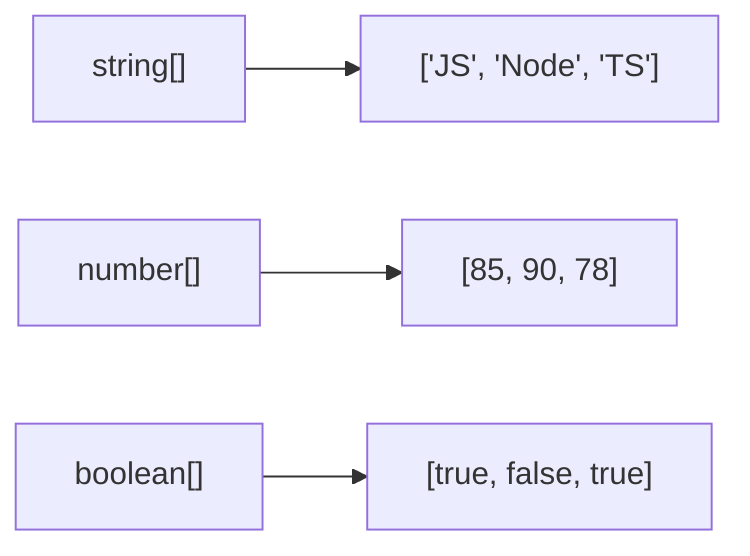
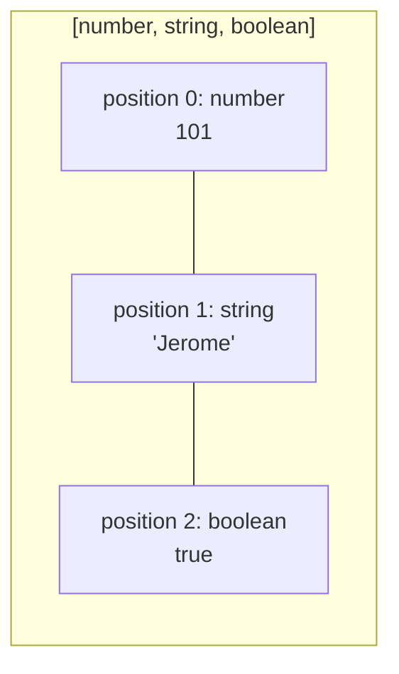
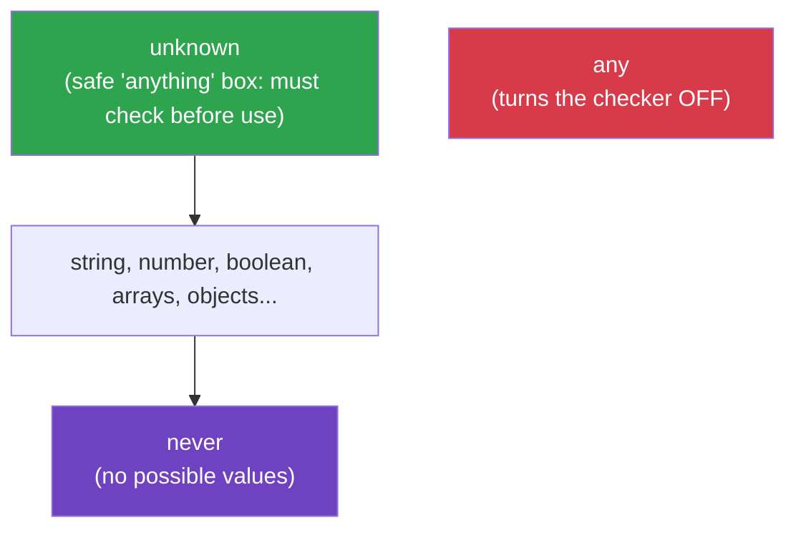
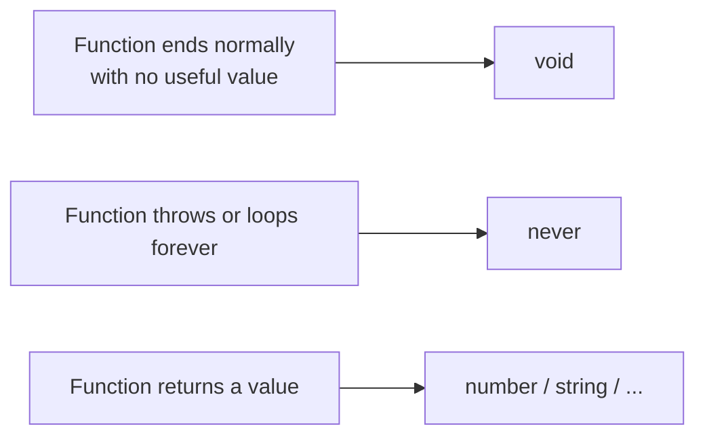
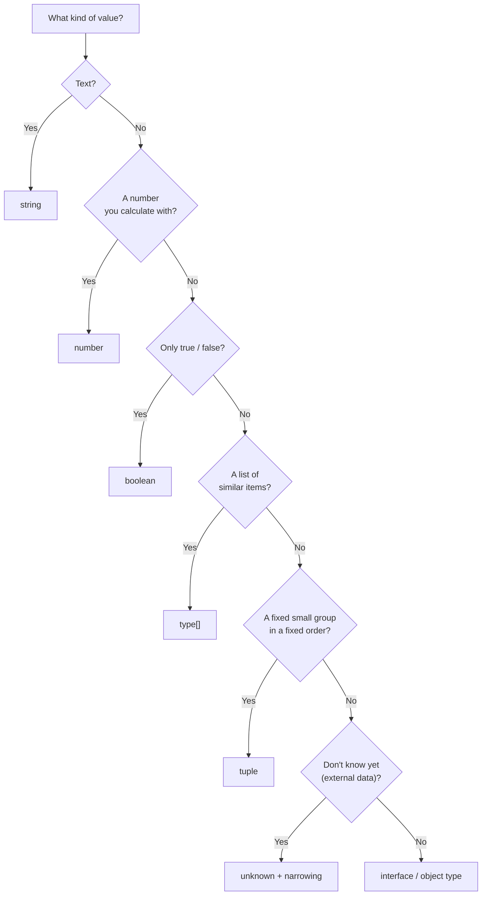
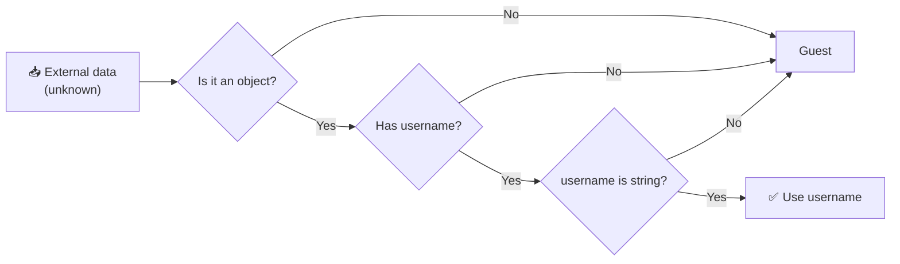

<div align="center">

# 🚀 Day 02 — Basic Types & Type Inference

### Learn the building blocks of the TypeScript type system, with practice at every step


**10 Days of TypeScript | Fundamentals → Real-World Backend Development**

*The goal is to understand not only **how** to declare types, but **when** and **why** to use them.*

</div>

---

## 🧭 How to Use This Guide

| Step | What to do | Time |
|:---:|---|:---:|
| 1️⃣ | Quick **Day 1 recap** | 10 min |
| 2️⃣ | Read each type section and **run every example yourself** | 90 min |
| 3️⃣ | Read **Type Inference** and **Any vs Unknown** twice (most important!) | 30 min |
| 4️⃣ | Complete **Tasks Level 1 → 3** (don't peek at solutions) | 70 min |
| 5️⃣ | Solve the **Debugging Challenges** | 20 min |
| 6️⃣ | Build the **Student Management mini project** | 45 min |
| 7️⃣ | **Quiz** + **Interview Questions** | 30 min |

> [!TIP]
> **Golden rule:** Type the code yourself. Break it on purpose. Read the error. That's how types become natural.

> [!IMPORTANT]
> **Running multiple practice files in the same project?**
> A `.ts` file with no `import`/`export` is treated as a *global script*. Two files that both declare `const age` will clash with the error `Cannot redeclare block-scoped variable 'age'`.
> **Fix:** add this line at the very top of every practice file:
> ```typescript
> export {};
> ```
> This turns the file into a module with its own scope.

---

## 📌 Table of Contents

| # | Section |
|:-:|---|
| 0 | [🔁 Day 1 Recap](#-day-1-recap) |
| 1 | [🎯 Learning Objectives](#-learning-objectives) |
| 2 | [📖 What Are Types?](#-what-are-types-in-typescript) |
| 3 | [🏷️ Type Annotations](#️-type-annotations) |
| 4 | [🔤 String](#-1-string-type) |
| 5 | [🔢 Number](#-2-number-type) |
| 6 | [✅ Boolean](#-3-boolean-type) |
| 7 | [📚 Arrays](#-4-array-types) |
| 8 | [📦 Tuples](#-5-tuple-types) |
| 9 | [⚠️ any](#️-6-the-any-type) |
| 10 | [🛡️ unknown](#️-7-the-unknown-type) |
| 11 | [⚖️ any vs unknown](#️-any-vs-unknown) |
| 12 | [🔄 void](#-8-void-type) |
| 13 | [🚫 never](#-9-never-type) |
| 14 | [🎁 Bonus: null & undefined](#-bonus-null-and-undefined) |
| 15 | [🧠 Type Inference](#-type-inference) |
| 16 | [🆚 Annotation vs Inference](#-type-annotations-vs-type-inference) |
| 17 | [🗺️ Which Type Should I Use?](#️-which-type-should-i-use) |
| 18 | [🌍 Real-World Backend Example](#-real-world-backend-example) |
| 19 | [❌ Common Mistakes & Errors](#-common-mistakes--error-messages) |
| 20 | [🧪 Hands-On Tasks](#-hands-on-tasks) |
| 21 | [🐞 Debugging Challenges](#-debugging-challenges) |
| 22 | [🏗️ Mini Project](#️-mini-project-student-management) |
| 23 | [📝 Quiz](#-quiz-test-yourself) |
| 24 | [🎤 Interview Questions](#-interview-questions) |
| 25 | [📄 Cheat Sheet](#-day-2-cheat-sheet) |
| 26 | [📚 Glossary](#-glossary) |
| 27 | [🛟 Troubleshooting](#-troubleshooting) |
| 28 | [✅ Progress Tracker](#-progress-tracker) |

---

## 🔁 Day 1 Recap

Before we start, answer these **without looking** at Day 1:

1. What does `tsc` do?
2. What happens to type annotations after compilation?
3. Does an `interface` validate an incoming HTTP request at runtime?

<details>
<summary>✅ Check your answers</summary>

1. `tsc` checks TypeScript code and compiles it into JavaScript.
2. They are removed (erased). Only JavaScript remains.
3. No. Interfaces don't exist at runtime. External data needs runtime validation.

</details>

If you got all three, you're ready. 🎉

---

## 🎯 Learning Objectives

By the end of Day 2, you should be able to:

- [ ] Use `string`, `number` and `boolean` correctly
- [ ] Declare typed arrays and tuples
- [ ] Explain the difference between `any` and `unknown`
- [ ] Use `typeof` to narrow an `unknown` value safely
- [ ] Explain `void` and `never`
- [ ] Predict what type TypeScript will infer
- [ ] Decide when to annotate and when to let TypeScript infer
- [ ] Read common type errors and fix them
- [ ] Apply basic types to backend-style data

---

## 📖 What Are Types in TypeScript?

A **type** describes the **kind of value** a variable, parameter, property or expression can hold.

```typescript
let username: string = "Developer";
let age: number = 22;
let isLearning: boolean = true;
```

| Type | Represents | Examples |
|---|---|---|
| `string` | Text | `"Hello"`, `'Hi'`, `` `Hey` `` |
| `number` | Numbers (integer and decimal) | `22`, `499.99`, `-5` |
| `boolean` | True or false | `true`, `false` |

### 🧩 Analogy: labelled boxes

Imagine kitchen containers with labels:

| Container label | What you can put inside |
|---|---|
| 🧂 `salt` | Only salt |
| 🍚 `rice` | Only rice |
| 📦 `unknown` | Anything, but **check it before you cook with it** |

A type is a **label on a box**. TypeScript is the person who stops you from pouring rice into the salt jar.

```typescript
let age: number = 22;

// ❌ Type 'string' is not assignable to type 'number'.
age = "twenty-two";
```

> [!IMPORTANT]
> Type checking happens during **development and compilation**. Type annotations do **not** validate data at runtime.

---

## 🏷️ Type Annotations

A **type annotation** explicitly declares the expected type.

### Syntax

```typescript
let variableName: type = value;
//                ^^^^ the annotation
```

### Examples

```typescript
let username: string = "Jerome";
let age: number = 22;
let isDeveloper: boolean = true;
```

### Annotating functions

```typescript
function greet(name: string): string {
  return `Hello, ${name}!`;
}

console.log(greet("Developer"));
```

```text
Hello, Developer!
```

```text
function greet ( name: string ) : string
                 ^^^^^^^^^^^^        ^^^^^^
                 parameter type      return type
```

### Declaring first, assigning later

```typescript
let city: string;     // declared with a type, no value yet
city = "Chennai";     // ✅
city = 600001;        // ❌ Type 'number' is not assignable to type 'string'.
```

---

## 🔤 1. String Type

`string` represents **text**.

### Three ways to write strings

```typescript
const a: string = "double quotes";
const b: string = 'single quotes';
const c: string = `backticks (template literal)`;
```

### Template literals (very useful!)

```typescript
const firstName: string = "Jerome";
const lastName: string = "Larens";

const fullName: string = `${firstName} ${lastName}`;
console.log(fullName);
```

```text
Jerome Larens
```

Anything inside `${ ... }` is evaluated, so you can even do math:

```typescript
const price: number = 500;
console.log(`Total with tax: ₹${price * 1.18}`);
```

```text
Total with tax: ₹590
```

### Handy string properties and methods

```typescript
const email: string = "  Jerome@Example.com  ";
```

| Code | Result |
|---|---|
| `email.length` | `22` |
| `email.trim()` | `"Jerome@Example.com"` |
| `email.trim().toLowerCase()` | `"jerome@example.com"` |
| `email.includes("@")` | `true` |
| `"TypeScript".toUpperCase()` | `"TYPESCRIPT"` |
| `"TypeScript".slice(0, 4)` | `"Type"` |
| `"a,b,c".split(",")` | `["a", "b", "c"]` |
| `"Hello".startsWith("He")` | `true` |
| `"I like JS".replace("JS", "TS")` | `"I like TS"` |

> TypeScript knows these methods exist on strings, so your editor will **autocomplete** them. Try typing `email.` in VS Code!

### When to use `string`

- Usernames, emails, product names, descriptions
- Phone numbers and postal codes (they can start with `0`!)
- IDs that may contain letters, like `"ORD-1001"`

> [!TIP]
> **Best practice:** Phone numbers, pincodes and many IDs should be `string`, not `number`. A number would drop the leading zero: `0123` ≠ `"0123"`.

### 🧪 Mini practice

What's the type of each?

```typescript
const a = "hello";
const b = `hello ${1 + 1}`;
const c = "5";
```

<details>
<summary>Answer</summary>

All three are strings (`a` is the literal type `"hello"` as a `const`, but it's still a string). `"5"` is **text**, not a number.

</details>

---

## 🔢 2. Number Type

`number` represents **integers and decimals**. There is no separate `int` or `float`.

```typescript
const age: number = 22;
const price: number = 499.99;
const temperature: number = -5;
const hex: number = 0xff;   // 255
```

### Math

```typescript
const price: number = 500;
const quantity: number = 4;

console.log(price * quantity);  // 2000
console.log(price + quantity);  // 504
console.log(price / quantity);  // 125
console.log(price % 3);         // 2  (remainder)
console.log(2 ** 3);            // 8  (power)
```

### Useful number tools

| Code | Result | Note |
|---|---|---|
| `(3.14159).toFixed(2)` | `"3.14"` | ⚠️ returns a **string**! |
| `Math.round(4.6)` | `5` | |
| `Math.floor(4.9)` | `4` | |
| `Math.ceil(4.1)` | `5` | |
| `Math.max(3, 9, 5)` | `9` | |
| `Math.min(3, 9, 5)` | `3` | |
| `Number("42")` | `42` | string → number |
| `Number("abc")` | `NaN` | invalid conversion |
| `parseInt("42px")` | `42` | |
| `Number.isNaN(NaN)` | `true` | |

### Special values

```typescript
const a: number = Infinity;
const b: number = NaN;     // "Not a Number", but its type is still number!
```

### 🚨 Gotcha 1: floating-point math

```typescript
console.log(0.1 + 0.2);  // 0.30000000000000004
```

This is not a TypeScript bug. It's how JavaScript numbers work. For money, production systems often store **integer minor units** (like paise) or use a decimal library:

```typescript
const priceInPaise: number = 49999;           // ₹499.99
const priceInRupees: number = priceInPaise / 100;
```

### 🚨 Gotcha 2: `toFixed()` returns a string

```typescript
const rounded = (5).toFixed(2);   // "5.00"  <-- a string
// ❌ This won't compile:
// const x: number = (5).toFixed(2);
// ✅ Convert it back if you need a number:
const x: number = Number((5).toFixed(2));  // 5
```

### 🧪 Mini practice

What does this print?

```typescript
console.log(10 + 5 + "3");
console.log("3" + 10 + 5);
```

<details>
<summary>Answer</summary>

```text
153
3105
```

Left to right: `10 + 5 = 15`, then `15 + "3"` = `"153"`. In the second line, `"3" + 10` = `"310"`, then `"310" + 5` = `"3105"`. This is why TypeScript's type checking is so useful.

</details>

---

## ✅ 3. Boolean Type

`boolean` has exactly two values: `true` and `false`.

```typescript
const isLoggedIn: boolean = true;
const isAdmin: boolean = false;
```

### Comparisons produce booleans

```typescript
const age: number = 20;

const isAdult: boolean = age >= 18;       // true
const isTeen: boolean = age >= 13 && age <= 19;  // false
const isStudent: boolean = !isAdult;      // false
```

| Operator | Meaning | Example | Result |
|:-:|---|---|:-:|
| `===` | equal (strict) | `5 === 5` | `true` |
| `!==` | not equal | `5 !== 3` | `true` |
| `>` `<` `>=` `<=` | comparison | `5 >= 5` | `true` |
| `&&` | AND | `true && false` | `false` |
| `\|\|` | OR | `true \|\| false` | `true` |
| `!` | NOT | `!true` | `false` |

### Practical example

```typescript
const isAuthenticated: boolean = true;

if (isAuthenticated) {
  console.log("Access granted");
} else {
  console.log("Access denied");
}
```

### Common use cases

- Feature flags
- Login status
- Stock availability
- Success/failure results
- Configuration options

> [!WARNING]
> A `boolean` variable does not make something **secure**. Authorization must be enforced by trusted server-side logic, never just by a flag.

---

## 📚 4. Array Types

An **array** stores multiple values. The type says what each element must be.

### Syntax

```typescript
let variableName: type[] = [];
```



### String array

```typescript
const skills: string[] = ["JavaScript", "Node.js", "TypeScript"];
console.log(skills);
```

```text
[ 'JavaScript', 'Node.js', 'TypeScript' ]
```

### Number array

```typescript
const marks: number[] = [85, 90, 78];
console.log(marks);
```

```text
[ 85, 90, 78 ]
```

### Accessing items

```typescript
const skills: string[] = ["JavaScript", "Node.js", "TypeScript"];

console.log(skills[0]);       // "JavaScript"  (index starts at 0!)
console.log(skills[2]);       // "TypeScript"
console.log(skills.length);   // 3
```

### Common array methods

```typescript
const numbers: number[] = [10, 20, 30];

numbers.push(40);                    // add to end → [10, 20, 30, 40]
numbers.pop();                       // remove from end → [10, 20, 30]

const doubled: number[] = numbers.map((n) => n * 2);
console.log(numbers); // [ 10, 20, 30 ]
console.log(doubled); // [ 20, 40, 60 ]
```

| Method | What it does | Example | Result |
|---|---|---|---|
| `push(x)` | Add to the end | `[1,2].push(3)` | `[1,2,3]` |
| `pop()` | Remove last | `[1,2,3].pop()` | `3` |
| `includes(x)` | Contains? | `[1,2].includes(2)` | `true` |
| `indexOf(x)` | Position of x | `["a","b"].indexOf("b")` | `1` |
| `join(sep)` | Array → string | `["a","b"].join("-")` | `"a-b"` |
| `map(fn)` | Transform each item | `[1,2].map(n => n*2)` | `[2,4]` |
| `filter(fn)` | Keep matching items | `[1,2,3].filter(n => n>1)` | `[2,3]` |
| `reduce(fn, start)` | Combine into one value | `[1,2,3].reduce((s,n)=>s+n, 0)` | `6` |
| `slice(a, b)` | Copy a part | `[1,2,3].slice(0,2)` | `[1,2]` |

### TypeScript catches wrong items

```typescript
const numbers: number[] = [10, 20, 30];

// ❌ Argument of type 'string' is not assignable to parameter of type 'number'.
numbers.push("forty");
```

### `map`, `filter`, `reduce` keep the types flowing

```typescript
const prices: number[] = [100, 250, 400];

const withTax: number[] = prices.map((p) => p * 1.18);
const expensive: number[] = prices.filter((p) => p > 200);
const total: number = prices.reduce((sum, p) => sum + p, 0);
```

Hover over `p`, `sum`, `total` in VS Code. You'll see TypeScript already knows they're `number`.

### Alternative syntax

```typescript
const usernames: Array<string> = ["jerome", "alex", "sam"];  // same as string[]
```

> [!TIP]
> Prefer `string[]`. It's shorter and easier to read.

### ⚠️ Empty arrays need a type

```typescript
const names: string[] = [];   // ✅ clear
names.push("Arun");
```

Always annotate an empty array so TypeScript knows what it's allowed to hold.

### 🚨 Gotcha: `sort()` on numbers

```typescript
const nums: number[] = [10, 9, 1];
console.log(nums.sort());                 // [ 1, 10, 9 ]  ← sorted as TEXT!
console.log(nums.sort((a, b) => a - b));  // [ 1, 9, 10 ]  ← correct numeric sort
```

---

## 📦 5. Tuple Types

A **tuple** is an array with a **fixed structure**: known length, and a specific type at each position.

```typescript
const user: [number, string] = [101, "Jerome"];

console.log(user[0]);   // 101
console.log(user[1]);   // "Jerome"
```



### Array vs Tuple

| | Array `number[]` | Tuple `[number, string]` |
|---|---|---|
| Length | Any | Fixed |
| Types | All the same | Each position has its own |
| Use for | A list of similar things | A small group with a clear order |
| Example | `[85, 90, 78]` | `[101, "Jerome"]` |

### Wrong order = error

```typescript
// ❌ Type 'string' is not assignable to type 'number'.
// ❌ Type 'number' is not assignable to type 'string'.
const user: [number, string] = ["Jerome", 101];
```

### Named tuple elements (more readable)

```typescript
const product: [id: number, name: string, price: number] = [
  101,
  "Keyboard",
  2499,
];
```

Hover over `product` in VS Code and you'll see the labels. They're just documentation, but very helpful.

### Optional tuple elements

```typescript
const a: [number, string?] = [101];
const b: [number, string?] = [102, "Alex"];
```

### Destructuring a tuple

```typescript
const user: [number, string] = [101, "Jerome"];
const [id, name] = user;

console.log(id);    // 101
console.log(name);  // "Jerome"
```

### Returning a tuple from a function

```typescript
function getMinMax(numbers: number[]): [min: number, max: number] {
  return [Math.min(...numbers), Math.max(...numbers)];
}

const [min, max] = getMinMax([4, 9, 1, 7]);
console.log(min, max); // 1 9
```

This pattern is very common. (You'll see it again with React's `useState`.)

### 🚨 Gotcha: tuples can still `push`

```typescript
const point: [number, number] = [10, 20];
point.push(30);   // ⚠️ TypeScript allows this (a known limitation)
```

Use `readonly` to prevent it:

```typescript
const safePoint: readonly [number, number] = [10, 20];
// ❌ Property 'push' does not exist on type 'readonly [number, number]'.
// safePoint.push(30);
```

### When to use a tuple (and when not to)

| Use a tuple when... | Use an `interface` when... |
|---|---|
| 2–3 values, order is obvious | The data has many fields |
| Returning a pair like `[min, max]` | It represents a business entity (User, Order) |
| Temporary grouping | Readability matters more than brevity |

---

## ⚠️ 6. The `any` Type

`any` turns **off** type checking for a value. It's an escape hatch.

```typescript
let data: any = "Hello";

data = 100;       // ✅ allowed
data = true;      // ✅ allowed

data.toUpperCase();  // ✅ compiles... 💥 crashes at runtime (boolean has no toUpperCase)
```

TypeScript trusts you completely, so mistakes are found by **users**, not by the compiler.

### Why `any` is dangerous

- Removes type checks
- Allows incompatible assignments
- Hides bugs
- **Spreads**: values derived from `any` also become `any`

```typescript
const x: any = "5";
const y = x * 2;  // y is also 'any'. The bad type infects everything it touches.
```

### Where does `any` sneak in?

| Source | Example |
|---|---|
| You write it | `let a: any;` |
| `JSON.parse()` | `const obj = JSON.parse(text);` ← returns `any`! |
| Missing parameter type (if strict is off) | `function f(x) {}` |

> [!WARNING]
> `JSON.parse` returns `any`. Always put an explicit annotation: `const data: unknown = JSON.parse(text);`

> [!NOTE]
> **Rule:** Use `any` only if you have a specific reason and understand the trade-off. In this course, treat it as a last resort.

---

## 🛡️ 7. The `unknown` Type

`unknown` can hold **any value**, but TypeScript makes you **check** the type before using it.

> `unknown` = "I don't know what this is **yet**, so I'll check first."

```typescript
let data: unknown = "Hello TypeScript";

if (typeof data === "string") {
  console.log(data.toUpperCase());   // ✅ inside this block, data is a string
}
```

```text
HELLO TYPESCRIPT
```

### Narrowing with `typeof`

Checking a type to "unlock" it is called **narrowing**.

```typescript
function processValue(value: unknown): void {
  if (typeof value === "string") {
    console.log(value.trim());
    return;
  }

  if (typeof value === "number") {
    console.log(value.toFixed(2));
    return;
  }

  console.log("Unsupported value type");
}

processValue("  TypeScript  ");   // TypeScript
processValue(100);                // 100.00
processValue(true);               // Unsupported value type
```

### The `typeof` checks you can use

| Check | True for |
|---|---|
| `typeof x === "string"` | text |
| `typeof x === "number"` | numbers (including `NaN`) |
| `typeof x === "boolean"` | `true`/`false` |
| `typeof x === "object"` | objects, arrays **and `null`** ⚠️ |
| `typeof x === "undefined"` | `undefined` |
| `typeof x === "function"` | functions |
| `Array.isArray(x)` | arrays |
| `x === null` | `null` |

### 🚨 Gotcha: `typeof null === "object"`

```typescript
function isPlainObject(value: unknown): boolean {
  return typeof value === "object" && value !== null && !Array.isArray(value);
}

console.log(isPlainObject({ a: 1 }));  // true
console.log(isPlainObject(null));      // false
console.log(isPlainObject([1, 2]));    // false
```

Always check `!== null` when you test for `"object"`.

### Why `unknown` is useful

It's perfect for data from:

- External APIs
- `JSON.parse`
- User input
- Third-party libraries
- Anything you don't control

> [!IMPORTANT]
> `unknown` is a **compile-time** safety tool. It doesn't validate anything by itself. **You** write the runtime checks.

---

## ⚖️ `any` vs `unknown`

| Feature | `any` | `unknown` |
|---|:-:|:-:|
| Can hold any value | ✅ | ✅ |
| Can be assigned to any type freely | ✅ | ❌ (must narrow first) |
| Allows property access directly | ✅ | ❌ |
| Forces you to check first | ❌ | ✅ |
| Type safety | 🔴 Weak | 🟢 Strong |
| Recommended for untrusted data | ❌ | ✅ |

### Side by side

```typescript
// any: compiles, crashes later
let a: any = "Hello";
console.log(a.nonExistingMethod());      // ✅ compiles, 💥 runtime error

// unknown: compiler stops you
let u: unknown = "Hello";
// ❌ 'u' is of type 'unknown'.
// console.log(u.toUpperCase());

if (typeof u === "string") {
  console.log(u.toUpperCase());          // ✅ safe
}
```



> 🧠 **Memory trick:** `any` = "**A**ny**thing** goes, no questions asked." `unknown` = "I must **un**lock it first."

---

## 🔄 8. `void` Type

`void` is used for functions that **don't return a meaningful value**.

```typescript
function printMessage(message: string): void {
  console.log(message);
}

printMessage("Learning TypeScript");
```

### Compare

```typescript
function logSuccess(): void {
  console.log("Operation completed");     // does something, returns nothing useful
}

function getNumber(): number {
  return 100;                             // returns a value, so NOT void
}
```

### What if you try to return a value from `void`?

```typescript
function getName(): void {
  // ❌ Type 'string' is not assignable to type 'void'.
  return "Arun";
}
```

### Typical `void` functions

- Logging (`console.log`)
- Saving something and not returning a result
- Sending a notification
- Event handlers

> [!NOTE]
> `void` doesn't mean "does nothing". It means "the caller shouldn't expect a useful return value."

---

## 🚫 9. `never` Type

`never` represents a value that **never happens**.

### Use 1: Functions that always throw

```typescript
function throwError(message: string): never {
  throw new Error(message);
}
```

The function never finishes normally, so it never returns.

### Use 2: Infinite loops

```typescript
function runForever(): never {
  while (true) {
    // keeps running
  }
}
```

### Use 3: Exhaustive checking (a superpower!)

> 🔭 *Sneak peek:* `type Status = "pending" | "success" | "failed"` is a **union of literal types**. You'll study it fully on Day 5. For now, read it as "Status can only be one of these three strings."

```typescript
type Status = "pending" | "success" | "failed";

function handleStatus(status: Status): string {
  switch (status) {
    case "pending":
      return "Please wait";
    case "success":
      return "Completed";
    case "failed":
      return "Something went wrong";
    default: {
      const exhaustiveCheck: never = status;
      return exhaustiveCheck;
    }
  }
}
```

Now someone adds `"cancelled"` to `Status` but forgets to handle it. The compiler reports an error on `exhaustiveCheck`, so you find the missing case **at compile time**, not in production. 🎯

### `void` vs `never`

| `void` | `never` |
|---|---|
| Function **finishes**, returns nothing useful | Function **never finishes normally** |
| `console.log` wrappers | Functions that always `throw` |
| Common | Rare (but powerful) |



---

## 🎁 Bonus: `null` and `undefined`

You'll meet these constantly in real projects.

```typescript
let a: undefined = undefined;   // "no value assigned"
let b: null = null;             // "intentionally empty"
```

With `strict: true`, **`null` and `undefined` are NOT silently allowed** in other types:

```typescript
let name: string = "Arun";

// ❌ Type 'null' is not assignable to type 'string'.
name = null;
```

This is one of the biggest bug-preventers in TypeScript, because it stops the classic *"Cannot read properties of undefined"* crash. To allow it deliberately, use a union type (`string | null`). You'll learn that on Day 5.

| Value | Meaning |
|---|---|
| `undefined` | Not set yet / missing |
| `null` | Deliberately empty |

---

## 🧠 Type Inference

**Type inference** = TypeScript works out the type for you.

### Example 1: string

```typescript
let username = "Jerome";     // inferred: string

username = "Alex";           // ✅
// username = 100;           // ❌ Type 'number' is not assignable to type 'string'.
```

### Example 2: number

```typescript
let score = 100;             // inferred: number
```

### Example 3: boolean

```typescript
let isActive = true;         // inferred: boolean
```

### Example 4: arrays

```typescript
let skills = ["Node.js", "TypeScript"];   // inferred: string[]
let marks = [90, 85];                     // inferred: number[]
```

### Example 5: objects

```typescript
const student = { name: "Priya", age: 20 };
// inferred: { name: string; age: number }

student.age = 21;          // ✅
// student.age = "21";     // ❌ Type 'string' is not assignable to type 'number'.
// student.city;           // ❌ Property 'city' does not exist
```

### Example 6: function return type

```typescript
function add(a: number, b: number) {
  return a + b;            // return type inferred as number
}

const result = add(10, 20);   // result: number
```

### Example 7: `const` vs `let` (important!)

```typescript
const role = "admin";   // type: "admin"  (a literal type, can never change)
let role2 = "admin";    // type: string   (can be reassigned to any string)
```

| Declaration | Inferred type | Why |
|---|---|---|
| `let x = 5` | `number` | Can change to another number |
| `const x = 5` | `5` | Can never change |
| `let s = "hi"` | `string` | Can change to another string |
| `const s = "hi"` | `"hi"` | Can never change |
| `let ok = true` | `boolean` | |
| `const ok = true` | `true` | |

### 👀 How to *see* inferred types

In VS Code, **hover** over any variable. You'll see something like:

```text
let score: number
```

Make this a habit. It's the fastest way to learn.

### ⚠️ When inference needs help

```typescript
// ❌ Without a type, this is hard to understand:
let items = [];                 // evolving array: unclear

// ✅ Give it a type:
let items2: string[] = [];
```

```typescript
// ❌ Parameters can't be inferred from nothing:
function greet(name) { }        // Parameter 'name' implicitly has an 'any' type.

// ✅
function greet2(name: string) { }
```

---

## 🆚 Type Annotations vs Type Inference

| Annotation | Inference |
|---|---|
| You write the type | TypeScript decides |
| `const age: number = 22` | `const age = 22` |
| Clearer for contracts | Less repetition |

### ✅ Annotate these

| Place | Example |
|---|---|
| Function parameters | `function f(name: string)` |
| Public API / exported functions' return types | `function f(): number` |
| Important domain models | `interface User { ... }` |
| Empty arrays/objects | `const list: string[] = []` |
| Values from outside | `const data: unknown = ...` |

### ✅ Let TypeScript infer these

| Place | Example |
|---|---|
| Simple local variables | `const total = price * qty` |
| Obvious literals | `let isActive = true` |
| Callback parameters in `map`, `filter` | `nums.map(n => n * 2)` |

> [!TIP]
> Don't annotate everything just to look "strongly typed". **Useful** type information beats **maximum** annotations.

---

## 🗺️ Which Type Should I Use?



---

## 🌍 Real-World Backend Example

A user profile model:

```typescript
interface UserProfile {
  id: number;
  username: string;
  email: string;
  isActive: boolean;
  skills: string[];
}

const user: UserProfile = {
  id: 101,
  username: "jerome",
  email: "jerome@example.com",
  isActive: true,
  skills: ["Node.js", "TypeScript", "Express.js"],
};

function displayUser(profile: UserProfile): void {
  console.log(`User: ${profile.username}`);
  console.log(`Email: ${profile.email}`);
  console.log(`Active: ${profile.isActive}`);
  console.log(`Skills: ${profile.skills.join(", ")}`);
}

displayUser(user);
```

```text
User: jerome
Email: jerome@example.com
Active: true
Skills: Node.js, TypeScript, Express.js
```

### What did we apply?

| Code | Type used |
|---|---|
| `id` | `number` |
| `username`, `email` | `string` |
| `isActive` | `boolean` |
| `skills` | `string[]` |
| `displayUser` return | `void` |
| The whole user | `interface` |

### 🔐 Handling an API response safely

```typescript
function readUsername(responseBody: unknown): string {
  if (
    typeof responseBody === "object" &&
    responseBody !== null &&
    "username" in responseBody
  ) {
    const username = (responseBody as { username: unknown }).username;

    if (typeof username === "string") {
      return username;
    }
  }

  return "Guest";
}

console.log(readUsername({ username: "jerome" })); // jerome
console.log(readUsername({ username: 123 }));      // Guest
console.log(readUsername(null));                   // Guest
```



> [!WARNING]
> **Production note:** An interface is not a database schema and doesn't validate incoming requests. Validate external data separately, enforce database constraints, and implement authentication and authorization.

---

## ❌ Common Mistakes & Error Messages

### Mistakes

| # | Mistake | Better approach |
|:-:|---|---|
| 1 | `let data: any = ...` for unknown data | `let data: unknown = ...` and narrow |
| 2 | Thinking `let age = 22` accepts any value later | The type is fixed as `number` |
| 3 | Using a tuple when an interface is clearer | Use `interface` for entities |
| 4 | Using `void` when the function returns a value | Declare the real return type |
| 5 | Trusting `JSON.parse` output | Annotate as `unknown`, then validate |
| 6 | Storing phone/pincode as `number` | Use `string` |
| 7 | Forgetting `toFixed()` returns a string | Wrap with `Number(...)` if needed |
| 8 | Not annotating empty arrays | `const list: string[] = []` |
| 9 | Using `typeof x === "object"` without a `null` check | Add `x !== null` |
| 10 | Sorting numbers without a compare function | `.sort((a, b) => a - b)` |

### 📋 Errors you'll see on Day 2

| Error message (shortened) | Meaning | Fix |
|---|---|---|
| `Type 'string' is not assignable to type 'number'` | Wrong value type | Use the right type |
| `Argument of type 'string' is not assignable to parameter of type 'number'` | Wrong argument or `push` | Pass the right type |
| `'x' is of type 'unknown'` | Using `unknown` without narrowing | Add a `typeof` check |
| `Type 'string' is not assignable to type 'void'` | Returning a value from a `void` function | Change the return type |
| `A function returning 'never' cannot have a reachable end point` | `never` function can finish | Throw or loop forever |
| `Type 'null' is not assignable to type 'string'` | `strictNullChecks` is protecting you | Handle `null` explicitly |
| `Source has 2 element(s) but target requires 3` | Tuple has the wrong length | Match the tuple length |
| `Property 'x' does not exist on type 'Y'` | Typo or missing property | Check the name/type |

---

## 🧪 Hands-On Tasks

> [!IMPORTANT]
> - Create one file per task: `src/task1_1.ts`, `src/task1_2.ts`...
> - Put `export {};` at the top of each file.
> - Run: `npm run build && node dist/task1_1.js`
> - Try first, then check the solution.

### 🟢 Level 1: Warm-up (20 min)

#### Task 1.1 — Personal profile

Create variables for **name**, **age**, **email**, **is employed** and **programming skills**. Choose suitable types and print everything.

#### Task 1.2 — Product inventory

1. Create `products: string[]` and `prices: number[]`.
2. Add one new product and one new price.
3. Print both arrays.
4. Intentionally push a wrong type into each array and read the error.

#### Task 1.3 — User tuple

Create a tuple for `[User ID, Username, Is Active]` using `number`, `string`, `boolean`. Print each element using its index.

#### Task 1.4 — Void function

Write `logMessage(message: string)` that prints the message and returns nothing meaningful.

#### Task 1.5 — Never function

Write `fail(message: string)` that throws an `Error`. Its return type must be `never`.

<details>
<summary>✅ Level 1 solutions</summary>

**1.1**

```typescript
export {};

const fullName: string = "Jerome";
const age: number = 22;
const email: string = "jerome@example.com";
const isEmployed: boolean = false;
const skills: string[] = ["JavaScript", "TypeScript", "Node.js"];

console.log(fullName, age, email, isEmployed, skills);
```

**1.2**

```typescript
export {};

const products: string[] = ["Keyboard", "Mouse"];
const prices: number[] = [2500, 600];

products.push("Monitor");
prices.push(9000);

console.log(products); // [ 'Keyboard', 'Mouse', 'Monitor' ]
console.log(prices);   // [ 2500, 600, 9000 ]

// ❌ Argument of type 'number' is not assignable to parameter of type 'string'.
// products.push(123);
// ❌ Argument of type 'string' is not assignable to parameter of type 'number'.
// prices.push("free");
```

**1.3**

```typescript
export {};

const user: [number, string, boolean] = [101, "Jerome", true];

console.log(user[0]); // 101
console.log(user[1]); // Jerome
console.log(user[2]); // true
```

**1.4**

```typescript
export {};

function logMessage(message: string): void {
  console.log(message);
}

logMessage("Hello TypeScript");
```

**1.5**

```typescript
export {};

function fail(message: string): never {
  throw new Error(message);
}

fail("Something went wrong");
```

</details>

---

### 🟡 Level 2: Practice (30 min)

#### Task 2.1 — Predict the inference 🔍

For each line, write down the type TypeScript infers. Then **hover in VS Code** to verify.

```typescript
let a = 10;
const b = 10;
let c = "hi";
const d = true;
let e = [1, 2, 3];
const f = { name: "Arun", age: 5 };
const g = (x: number) => x > 5;
```

#### Task 2.2 — Safe formatter with `unknown`

Write `formatValue(value: unknown): string`:

| Input | Output |
|---|---|
| a string | uppercase version |
| a number | two decimal places (like `"100.00"`) |
| a boolean | `"Yes"` or `"No"` |
| an array | `"Array with N items"` |
| anything else | `"Unsupported type"` |

Test with: `"hello"`, `42`, `true`, `[1, 2, 3]`, `null`, `undefined`.

#### Task 2.3 — Min, max, average with a tuple

Write `getStats(marks: number[])` that returns a tuple `[min, max, average]`. Use named tuple elements and destructure the result.

#### Task 2.4 — Array toolbox

Given `const prices: number[] = [120, 450, 80, 999, 300];` write:

1. `getTotal(prices): number`
2. `getExpensive(prices, limit): number[]` (items above the limit)
3. `addTax(prices, rate): number[]` (rate in %)

#### Task 2.5 — Swap

Write `swap(pair: [number, string]): [string, number]` that reverses the tuple. `swap([1, "one"])` → `["one", 1]`.

<details>
<summary>✅ Level 2 solutions</summary>

**2.1**

| Line | Inferred type |
|---|---|
| `let a = 10` | `number` |
| `const b = 10` | `10` (literal) |
| `let c = "hi"` | `string` |
| `const d = true` | `true` (literal) |
| `let e = [1, 2, 3]` | `number[]` |
| `const f = {...}` | `{ name: string; age: number }` |
| `const g = ...` | `(x: number) => boolean` |

**2.2**

```typescript
export {};

function formatValue(value: unknown): string {
  if (typeof value === "string") {
    return value.toUpperCase();
  }
  if (typeof value === "number") {
    return value.toFixed(2);
  }
  if (typeof value === "boolean") {
    return value ? "Yes" : "No";
  }
  if (Array.isArray(value)) {
    return `Array with ${value.length} items`;
  }
  return "Unsupported type";
}

console.log(formatValue("hello"));    // HELLO
console.log(formatValue(42));         // 42.00
console.log(formatValue(true));       // Yes
console.log(formatValue([1, 2, 3]));  // Array with 3 items
console.log(formatValue(null));       // Unsupported type
console.log(formatValue(undefined));  // Unsupported type
```

**2.3**

```typescript
export {};

function getStats(
  marks: number[]
): [min: number, max: number, average: number] {
  const min = Math.min(...marks);
  const max = Math.max(...marks);
  const average = marks.reduce((sum, m) => sum + m, 0) / marks.length;
  return [min, max, average];
}

const [min, max, average] = getStats([70, 85, 90, 100]);
console.log(min, max, average); // 70 100 86.25
```

**2.4**

```typescript
export {};

const prices: number[] = [120, 450, 80, 999, 300];

function getTotal(items: number[]): number {
  return items.reduce((sum, p) => sum + p, 0);
}

function getExpensive(items: number[], limit: number): number[] {
  return items.filter((p) => p > limit);
}

function addTax(items: number[], rate: number): number[] {
  return items.map((p) => p + (p * rate) / 100);
}

console.log(getTotal(prices));            // 1949
console.log(getExpensive(prices, 300));   // [ 450, 999 ]
console.log(addTax(prices, 18));          // values like 141.6, 531, 94.4, 1178.82, 354
```

> Floating-point values may print with tiny extra decimals on some inputs. That's the number gotcha you learned earlier.

**2.5**

```typescript
export {};

function swap(pair: [number, string]): [string, number] {
  const [num, text] = pair;
  return [text, num];
}

console.log(swap([1, "one"])); // [ 'one', 1 ]
```

</details>

---

### 🔴 Level 3: Challenge (40 min)

#### Task 3.1 — Safe JSON reader

1. Write `parseJsonSafely(text: string): unknown` that returns the parsed value, or `null` if the text is invalid JSON.
2. Write `getUsername(jsonText: string): string` that returns the `username` **only if** it exists and is a string. Otherwise return `"Guest"`.

Test with:

```text
'{"username":"jerome"}'     → jerome
'{"username":123}'          → Guest
'not json'                  → Guest
'null'                      → Guest
```

#### Task 3.2 — Exhaustive `never` check

1. Create `type Status = "pending" | "success" | "failed"` and a `handleStatus` function with a `never` default check (see the `never` section).
2. Add `"cancelled"` to `Status`. What error do you get?
3. Handle the new case and make the error disappear.

#### Task 3.3 — Tuple → Interface refactor

You're given this tuple-based code:

```typescript
const product: [number, string, number] = [101, "Keyboard", 2499];
```

1. List **two problems** with this style for a real project.
2. Refactor it to an `interface Product`.
3. Write `describeProduct(product: Product): string` returning `"#101 Keyboard - ₹2499"`.

#### Task 3.4 — Catch the `any` leak 🕵️

1. Write: `const obj = JSON.parse('{"x": 1}');`
2. Hover over `obj`. What type is it?
3. Write `obj.anything.goes.here;`. Does TypeScript complain?
4. Change to `const obj: unknown = JSON.parse(...)`. What happens to `obj.x`?

#### Task 3.5 — Grade book (arrays + tuples + functions)

Write `getGradeBook(names: string[], marks: number[]): [string, number][]` that pairs each name with its mark. Then print each pair like `Priya: 92`.

<details>
<summary>✅ Level 3 solutions</summary>

**3.1**

```typescript
export {};

function parseJsonSafely(text: string): unknown {
  try {
    return JSON.parse(text);
  } catch {
    return null;
  }
}

function getUsername(jsonText: string): string {
  const parsed = parseJsonSafely(jsonText);

  if (typeof parsed === "object" && parsed !== null && "username" in parsed) {
    const username = (parsed as { username: unknown }).username;
    if (typeof username === "string") {
      return username;
    }
  }

  return "Guest";
}

console.log(getUsername('{"username":"jerome"}')); // jerome
console.log(getUsername('{"username":123}'));      // Guest
console.log(getUsername("not json"));              // Guest
console.log(getUsername("null"));                  // Guest
```

**3.2**

After adding `"cancelled"`, the compiler reports something like:

```text
Type '"cancelled"' is not assignable to type 'never'.
```

Fix:

```typescript
type Status = "pending" | "success" | "failed" | "cancelled";

function handleStatus(status: Status): string {
  switch (status) {
    case "pending":
      return "Please wait";
    case "success":
      return "Completed";
    case "failed":
      return "Something went wrong";
    case "cancelled":
      return "Order cancelled";
    default: {
      const exhaustiveCheck: never = status;
      return exhaustiveCheck;
    }
  }
}
```

**3.3**

Problems: (1) you must remember what each position means (`0` = id? `2` = price?); (2) adding a field changes positions and can silently break code.

```typescript
export {};

interface Product {
  id: number;
  name: string;
  price: number;
}

function describeProduct(product: Product): string {
  return `#${product.id} ${product.name} - ₹${product.price}`;
}

console.log(describeProduct({ id: 101, name: "Keyboard", price: 2499 }));
// #101 Keyboard - ₹2499
```

**3.4**

2. `any`
3. No complaint. That's the danger.
4. With `unknown`, `obj.x` is an error: `'obj' is of type 'unknown'.` You must narrow first.

**3.5**

```typescript
export {};

function getGradeBook(names: string[], marks: number[]): [string, number][] {
  const result: [string, number][] = [];
  for (let i = 0; i < names.length; i++) {
    result.push([names[i], marks[i]]);
  }
  return result;
}

const book = getGradeBook(["Priya", "Arun"], [92, 75]);
for (const [name, mark] of book) {
  console.log(`${name}: ${mark}`);
}
// Priya: 92
// Arun: 75
```

> Edge case to think about: what if `names` and `marks` have different lengths? Types can't catch that. Your logic must.

</details>

---

## 🐞 Debugging Challenges

Predict the error **before** compiling.

#### 🐛 Challenge 1
```typescript
const scores: number[] = [90, "85", 70];
```

#### 🐛 Challenge 2
```typescript
const user: [number, string] = ["Arun", 1];
```

#### 🐛 Challenge 3
```typescript
function showLength(value: unknown): void {
  console.log(value.length);
}
```

#### 🐛 Challenge 4
```typescript
function getName(): void {
  return "Arun";
}
```

#### 🐛 Challenge 5
```typescript
function fail(message: string): never {
  console.log(message);
}
```

#### 🐛 Challenge 6
```typescript
let isActive = true;
isActive = "yes";
```

#### 🐛 Challenge 7
```typescript
let ids: number[] = [1, 2, 3];
ids.push("4");
```

<details>
<summary>✅ Answers</summary>

| # | Error | Fix |
|:-:|---|---|
| 1 | `Type 'string' is not assignable to type 'number'.` | Use `85` instead of `"85"` |
| 2 | Two errors: `Type 'string' is not assignable to type 'number'` and `Type 'number' is not assignable to type 'string'` | `[1, "Arun"]` |
| 3 | `'value' is of type 'unknown'.` | `if (typeof value === "string") { ... }` |
| 4 | `Type 'string' is not assignable to type 'void'.` | Change the return type to `string` |
| 5 | `A function returning 'never' cannot have a reachable end point.` | `throw new Error(message);` |
| 6 | `Type 'string' is not assignable to type 'boolean'.` (inferred type is `boolean`) | `isActive = false;` |
| 7 | `Argument of type 'string' is not assignable to parameter of type 'number'.` | `ids.push(4);` |

</details>

---

## 🏗️ Mini Project: Student Management

Build a type-safe student profile system. This uses **everything** from Day 2.

### 📋 Requirements

Create `src/students.ts`:

1. `interface Student` with: `id` (number), `name` (string), `age` (number), `course` (string), `isActive` (boolean), `skills` (string[]), `marks` (number[]).
2. `displayStudent(student: Student): void`
3. `countSkills(student: Student): number`
4. `calculateAverage(marks: number[]): number`
5. `getGrade(average: number): string`
   - 90 or more → `"A"`
   - 75 or more → `"B"`
   - 60 or more → `"C"`
   - otherwise → `"D"`
6. `printTopStudent(students: Student[]): void`
7. Create an array of at least 3 students and print everything, plus how many are active.

### 🎯 Expected output (sample)

```text
------------------------------
Student #1: Priya
Age: 20 | Course: CSE | Active: Yes
Skills (2): Node.js, TypeScript
Average: 91.67 | Grade: A
------------------------------
Student #2: Arun
Age: 21 | Course: IT | Active: Yes
Skills (3): HTML, CSS, JavaScript
Average: 71.67 | Grade: C
------------------------------
Student #3: Meena
Age: 22 | Course: ECE | Active: No
Skills (1): C
Average: 57.67 | Grade: D
------------------------------
Active students: 2
🏆 Top student: Priya (91.67)
```

### 🧱 Starter code

```typescript
export {};

interface Student {
  id: number;
  name: string;
  age: number;
  course: string;
  isActive: boolean;
  skills: string[];
  marks: number[];
}

function calculateAverage(marks: number[]): number {
  // TODO
  return 0;
}

function getGrade(average: number): string {
  // TODO
  return "";
}

function countSkills(student: Student): number {
  // TODO
  return 0;
}

function displayStudent(student: Student): void {
  // TODO
}

function printTopStudent(students: Student[]): void {
  // TODO
}

const students: Student[] = [
  {
    id: 1,
    name: "Priya",
    age: 20,
    course: "CSE",
    isActive: true,
    skills: ["Node.js", "TypeScript"],
    marks: [92, 88, 95],
  },
  // TODO: add Arun and Meena
];

// TODO: print all students, active count, and top student
```

### 🌟 Bonus ideas

- [ ] Add `getStudentsByCourse(students, course): Student[]`
- [ ] Add `getAllSkills(students): string[]` (every skill from every student)
- [ ] Return a tuple `[highest, lowest]` from a function for the marks
- [ ] Handle an empty `marks` array safely (avoid `NaN`)
- [ ] Handle an empty `students` array in `printTopStudent`

<details>
<summary>✅ Sample solution</summary>

```typescript
export {};

interface Student {
  id: number;
  name: string;
  age: number;
  course: string;
  isActive: boolean;
  skills: string[];
  marks: number[];
}

function calculateAverage(marks: number[]): number {
  if (marks.length === 0) {
    return 0;
  }
  const total = marks.reduce((sum, m) => sum + m, 0);
  return total / marks.length;
}

function getGrade(average: number): string {
  if (average >= 90) return "A";
  if (average >= 75) return "B";
  if (average >= 60) return "C";
  return "D";
}

function countSkills(student: Student): number {
  return student.skills.length;
}

function displayStudent(student: Student): void {
  const average = calculateAverage(student.marks);

  console.log("------------------------------");
  console.log(`Student #${student.id}: ${student.name}`);
  console.log(
    `Age: ${student.age} | Course: ${student.course} | Active: ${
      student.isActive ? "Yes" : "No"
    }`
  );
  console.log(
    `Skills (${countSkills(student)}): ${student.skills.join(", ")}`
  );
  console.log(`Average: ${average.toFixed(2)} | Grade: ${getGrade(average)}`);
}

function printTopStudent(students: Student[]): void {
  if (students.length === 0) {
    console.log("No students found");
    return;
  }

  let top = students[0];
  for (const student of students) {
    if (calculateAverage(student.marks) > calculateAverage(top.marks)) {
      top = student;
    }
  }

  console.log(
    `🏆 Top student: ${top.name} (${calculateAverage(top.marks).toFixed(2)})`
  );
}

const students: Student[] = [
  {
    id: 1,
    name: "Priya",
    age: 20,
    course: "CSE",
    isActive: true,
    skills: ["Node.js", "TypeScript"],
    marks: [92, 88, 95],
  },
  {
    id: 2,
    name: "Arun",
    age: 21,
    course: "IT",
    isActive: true,
    skills: ["HTML", "CSS", "JavaScript"],
    marks: [70, 65, 80],
  },
  {
    id: 3,
    name: "Meena",
    age: 22,
    course: "ECE",
    isActive: false,
    skills: ["C"],
    marks: [55, 60, 58],
  },
];

for (const student of students) {
  displayStudent(student);
}
console.log("------------------------------");

const activeCount: number = students.filter((s) => s.isActive).length;
console.log(`Active students: ${activeCount}`);

printTopStudent(students);
```

</details>

---

## 📝 Quiz: Test Yourself

**Q1.** How do you declare an array of strings?
- A) `let a: string = []`
- B) `let a: string[] = []`
- C) `let a: [string] = []`
- D) `let a: array = []`

**Q2.** What is `[number, string]` called?
- A) Array
- B) Union
- C) Tuple
- D) Interface

**Q3.** Best type for data parsed from an unknown API response?
- A) `any`
- B) `string`
- C) `unknown`
- D) `never`

**Q4.** Which return type fits a function that always throws?
- A) `void`
- B) `never`
- C) `null`
- D) `undefined`

**Q5.** What is the inferred type of `const role = "admin";`?
- A) `string`
- B) `"admin"`
- C) `any`
- D) `unknown`

**Q6.** What happens here? `let y = 5; y = "5";`
- A) Works fine
- B) Runtime error only
- C) Compile-time type error
- D) `y` becomes `any`

**Q7.** Main difference between `any` and `unknown`?
- A) None
- B) `unknown` forces you to narrow before use
- C) `any` is safer
- D) `unknown` only holds strings

**Q8.** What does `(5).toFixed(2)` return?
- A) The number `5`
- B) The number `5.00`
- C) The string `"5.00"`
- D) `NaN`

**Q9.** Does `unknown` validate API data automatically at runtime?
- A) Yes
- B) Only with strict mode
- C) No, you must write the checks
- D) Only for strings

**Q10.** What type does `JSON.parse()` return?
- A) `unknown`
- B) `object`
- C) `string`
- D) `any`

<details>
<summary>✅ Answers</summary>

| Q | Answer | Why |
|:-:|:-:|---|
| 1 | **B** | `type[]` is the array syntax |
| 2 | **C** | Fixed length with types per position |
| 3 | **C** | Forces safe checking |
| 4 | **B** | The function never returns normally |
| 5 | **B** | `const` gives a literal type |
| 6 | **C** | `y` is inferred as `number` |
| 7 | **B** | That's the key difference |
| 8 | **C** | `toFixed` returns a string |
| 9 | **C** | `unknown` is compile-time only |
| 10 | **D** | It returns `any`, so annotate it as `unknown` |

**Scoring:** 9–10 🏆 Excellent · 7–8 👍 Good · 5–6 📖 Revise `any`/`unknown` and inference · below 5 🔁 Re-read and retry

</details>

---

## 🎤 Interview Questions

### 🟢 Beginner

**1. What is a type annotation?**
An explicit declaration of the expected type of a variable, parameter, property or other typed expression.

**2. What is type inference?**
TypeScript determines a type from a value or expression without an explicit annotation.

**3. Difference between `string` and `number`?**
`string` is text; `number` is JavaScript numeric values (integers and decimals).

**4. How do you declare an array of strings?**
```typescript
const skills: string[] = ["Node.js", "TypeScript"];
```

**5. What is a tuple?**
An array with a known length and a specific type at each position.

### 🟡 Intermediate

**6. `any` vs `unknown`?**
`any` disables most type checking for the value. `unknown` accepts any value but requires narrowing before type-specific operations.

**7. `void` vs `never`?**
`void` means no meaningful return value (function finishes). `never` means the function never returns normally (throws or loops forever) or a value cannot exist.

**8. Must every variable be annotated?**
No. TypeScript infers types from initial values and expressions.

**9. Can `unknown` hold a string, number or boolean?**
Yes, but you must narrow or validate before using it as a specific type.

**10. What happens if you assign a string to a `number` variable?**
The compiler reports a type error.

### 🔴 Practical

**11. Why is `any` discouraged?**
It removes type checks, can hide bugs, and spreads through code that touches it.

**12. When use a tuple instead of an array?**
When positions and types form a clear contract (like `[min, max]`). Use arrays for collections of similar items.

**13. Does `unknown` validate API data?**
No. It forces you to narrow, but runtime validation is still your job.

**14. Why is `const x = "a"` typed differently from `let x = "a"`?**
`const` can't change, so TypeScript infers the literal type `"a"`. `let` can be reassigned, so it infers `string`.

**15. Why is `JSON.parse` a risk in TypeScript?**
It returns `any`, which silently disables type checking. Annotate the result as `unknown` and validate it.

**16. What is narrowing?**
Using checks like `typeof`, `Array.isArray` or `=== null` so TypeScript knows a more specific type inside a code block.

**17. Should every function declare its return type?**
Not necessarily. Explicit return types are valuable for public/exported functions and complex logic. Inference is often fine for simple local functions.

**18. Why store a phone number as `string`?**
It may have leading zeros, a `+` sign or formatting, and you never do math on it.

> 💬 **Practice tip:** Explain each answer **out loud**, as if teaching a friend.

---

## 📄 Day 2 Cheat Sheet

```typescript
// Primitives
let name: string = "Arun";
let age: number = 22;
let ok: boolean = true;

// Arrays
let skills: string[] = ["TS", "Node"];
let marks: number[] = [90, 85];

// Tuples
let user: [number, string] = [1, "Arun"];
let point: readonly [number, number] = [1, 2];

// Special types
let a: any;              // checker OFF (avoid!)
let u: unknown;          // safe unknown (narrow first)
function log(): void {}                       // no useful return
function fail(): never { throw new Error(); } // never returns

// Narrowing
if (typeof u === "string") { u.toUpperCase(); }
if (Array.isArray(u)) { u.length; }
if (u !== null && typeof u === "object") { /* object */ }

// Inference
let n = 5;          // number
const c = 5;        // 5 (literal)
```

### 🧠 Quick decisions

| Situation | Use |
|---|---|
| Text | `string` |
| Math / counting | `number` |
| Yes/no | `boolean` |
| List of same things | `type[]` |
| Small fixed group | tuple |
| External / untrusted data | `unknown` |
| Function returns nothing useful | `void` |
| Function never returns | `never` |
| Entity with many fields | `interface` |

---

## 📚 Glossary

| Term | Meaning |
|---|---|
| **Primitive** | Basic value type: `string`, `number`, `boolean` |
| **Array** | Ordered list of values of one type |
| **Tuple** | Fixed-length array with a type per position |
| **Narrowing** | Using checks to make a type more specific |
| **Type guard** | A check like `typeof x === "string"` |
| **Literal type** | An exact value as a type, e.g. `"admin"` |
| **Union type** | One of several types, e.g. `string \| number` (Day 5) |
| **Inference** | TypeScript deciding a type automatically |
| **Annotation** | A type you write explicitly |
| **`any`** | Type that disables checking |
| **`unknown`** | Safe "anything" type that must be narrowed |
| **`void`** | No meaningful return value |
| **`never`** | A value that never occurs |
| **`NaN`** | "Not a Number" (still of type `number`) |
| **Destructuring** | Unpacking values: `const [a, b] = arr` |
| **Template literal** | `` `Hello ${name}` `` |

---

## 🛟 Troubleshooting

| Problem | Cause | Fix |
|---|---|---|
| `Cannot redeclare block-scoped variable` | Two practice files with the same variable names | Add `export {};` to the top of each file |
| `'x' is of type 'unknown'` | Using `unknown` without a check | Narrow with `typeof` |
| `Parameter 'x' implicitly has an 'any' type` | Missing parameter type | Add an annotation |
| `Type 'null' is not assignable to...` | Strict null checks | Handle `null` explicitly |
| Output looks old | Forgot to rebuild | `npm run build` then `node dist/<file>.js` |
| `Cannot find name 'console'` | Node types missing | `npm i -D @types/node` and keep `"types": ["node"]` |
| `NaN` in output | Dividing by zero or bad conversion | Check inputs, e.g. empty arrays |
| Wrong sort order for numbers | Default sort is alphabetical | `.sort((a, b) => a - b)` |

---

## ✅ Progress Tracker

### Concepts
- [ ] I understand `string`, `number`, `boolean`
- [ ] I can create and use typed arrays
- [ ] I can explain tuples and when to use them
- [ ] I can explain `any` vs `unknown` in my own words
- [ ] I can narrow `unknown` using `typeof`
- [ ] I understand `void` vs `never`
- [ ] I can predict inferred types
- [ ] I know why `JSON.parse` is risky

### Practice
- [ ] Level 1 tasks done
- [ ] Level 2 tasks done
- [ ] Level 3 tasks done
- [ ] Debugging challenges solved
- [ ] Student Management mini project finished
- [ ] Quiz score: ____ / 10
- [ ] Interview questions answered out loud

### Reflection

> **One thing I learned today:** ______________________
>
> **One thing I'm still confused about:** ______________________
>
> **One thing I'll practice tomorrow:** ______________________

---

## 📝 Day 2 Key Takeaways

- Annotations **declare** types; inference **discovers** them.
- Arrays hold many similar items; tuples describe a fixed structure.
- `any` weakens type safety; `unknown` forces safe narrowing.
- `void` and `never` describe different kinds of function behavior.
- `JSON.parse` returns `any`, so treat its result as `unknown`.
- Types improve reliability but **don't replace** runtime validation.

**The main lesson:** Use types to communicate intent and catch mistakes early, not as syntax to memorize.

---

## 🔜 Day 3 — Functions & Type Safety

Tomorrow we explore:

- Function parameter and return types
- Optional and default parameters
- Rest parameters
- Function types
- Arrow functions
- Function overloads
- Designing reliable functions for backend applications

---

## 📚 Official Resources

| Resource | Link |
|---|---|
| TypeScript Handbook | https://www.typescriptlang.org/docs/handbook/intro.html |
| Everyday Types | https://www.typescriptlang.org/docs/handbook/2/everyday-types.html |
| More on Functions | https://www.typescriptlang.org/docs/handbook/2/functions.html |
| Narrowing | https://www.typescriptlang.org/docs/handbook/2/narrowing.html |
| TypeScript Playground | https://www.typescriptlang.org/play/ |

---

<div align="center">

## 💙 Learning in Public

This is Day 2 of my 10-day TypeScript journey: practical examples, hands-on exercises, and real-world backend development.

### **Same Learning. Stronger Code. Bigger Opportunities.** 🚀

`#TypeScript` `#NodeJS` `#JavaScript` `#BackendDevelopment` `#WebDevelopment` `#LearningInPublic`

</div>
